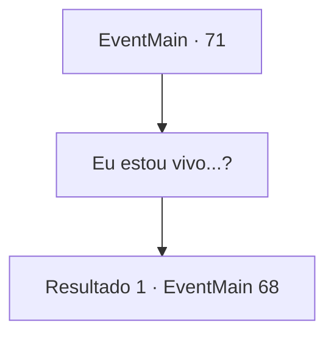

# Eventos principais · 71

[Índice da tabela](index.md) · [Índice geral](../index.md)

ID: `pt:EventMain:71` · Fonte: `EventMain4` · Versão: 1.2.47.

Mapeamento estático dos arquivos; a disponibilidade e a execução dependem do estado da run.

## Texto do evento

*Sem texto no arquivo.*

## Dados de entrada

```json
{
  "id": 71,
  "grade": 1,
  "normalGoal": "",
  "required": ""
}
```

## Mapa das escolhas



## Escolhas e resultados

### Escolha 1

Eu estou vivo...?

Requisitos e outros campos da escolha:

```json
{
  "required": ""
}
```

#### Resultado 1.1

Você não tem ideia de quanto tempo se passou enquanto você abre os olhos. Você está em uma tenda. 

 "Você está acordado!"

 Você se vira para encontrar um jovem cuidando de você. Ele é um dos soldados do acampamento. Ele olha para você com um sorriso respeitoso, e atualiza você sobre o que aconteceu depois que você caiu. Os elfos recuaram e o Reino decidiu promovê-lo por suas conquistas. 

 "Não tenho certeza se isso é apropriado, mas você realmente lutou como o próprio diabo!"

 Ele fala animadamente por um tempo sobre suas façanhas antes de explicar. 

 "Oh, certo! Um mensageiro está esperando por você! É melhor você ir vê-lo!"

 "{1}! É um prazer finalmente conhecê-lo."

 Um homem de terno azul marinho se aproxima de você. Ele se apresenta como mensageiro e lhe entrega uma carta com o selo do rei. |drawing_kingsMessenger| A carta fala de uma decisão de colocar as fronteiras sob a dependência do Barão, e pergunta se você pode assumir a posição. O mensageiro ajusta seu monóculo e fala. 

 "Vou levá-lo para a capital, Barão {1}."


Continuação registrada: [Evento 68](0068.md) na mesma tabela.

```json
{
  "required": "",
  "chance": "1",
  "nextEvent": 68,
  "type": 2,
  "reward": ""
}
```

## Referências que chegam a este evento

- [Evento 70 · escolha 1 · resultado 1](0070.md#escolha-1)
