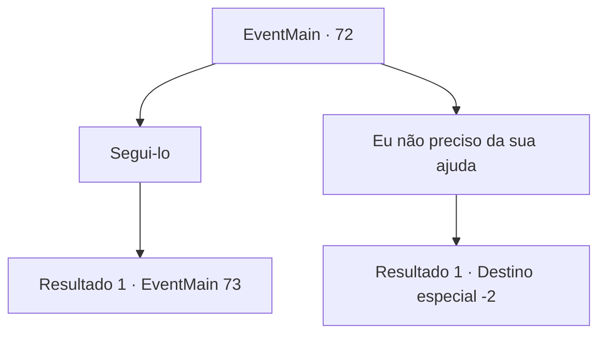

# Eventos principais · 72

[Índice da tabela](index.md) · [Índice geral](../index.md)

ID: `pt:EventMain:72` · Fonte: `EventMain4` · Versão: 1.2.47.

Mapeamento estático dos arquivos; a disponibilidade e a execução dependem do estado da run.

## Texto do evento

Um estranho elfo se aproxima de você. Ele olha para o pergaminho e depois de volta para você. Então ele curva-se graciosamente e cumprimenta você . 

 "Prazer em conhecê-lo, {1}. O Capitão Irelle manda seus cumprimentos."

 Ele lhe diz que vem em nome de Irelle para ajudá-lo.

## Dados de entrada

```json
{
  "id": 72,
  "grade": 1,
  "normalGoal": "",
  "required": "13_0_9|1_2_50|5_72_1"
}
```

## Mapa das escolhas



## Escolhas e resultados

### Escolha 1

Segui-lo

Requisitos e outros campos da escolha:

```json
{
  "required": ""
}
```

#### Resultado 1.1

Você segue o elfo até uma forja nos limites de uma vila élfica. Clamões claros como cristal enchem o ar, diferente de qualquer som que você já ouviu a arma de um homem fazer. Um elfo de aparência estranha se aproxima de você enquanto você olha em volta da forja com admiração. Ele é curto para um elfo e tem uma barba espessa. Seus ombros são largos e suas mãos parecem grossas e robustas. 

 "Prazer em conhecê-la. O nome é Hundor. Sou apenas um simples ferreiro. Capitão me pediu para ajudá-lo."

 Hundor diz, flexionando os dedos. 

 "Dê-me os materiais certos e verei o que posso fazer. O que você precisa?"


Continuação registrada: [Evento 73](0073.md) na mesma tabela.

```json
{
  "required": "",
  "chance": "1",
  "nextEvent": 73,
  "type": 2,
  "reward": ""
}
```

### Escolha 2

Eu não preciso da sua ajuda

Requisitos e outros campos da escolha:

```json
{
  "required": ""
}
```

#### Resultado 2.1

Você imediatamente recusa a oferta do elfo. Ele se curva novamente, graciosamente. 

 "Não sinto nenhuma hesitação. Que assim seja."

 O elfo se despede e vai embora.

Continuação registrada: [Destino especial `-2`](../destinos-especiais.md).

```json
{
  "required": "",
  "chance": "1",
  "nextEvent": -2,
  "type": 2,
  "reward": "0_2_1|5_72_2"
}
```

## Referências que chegam a este evento

Nenhum `nextEvent` positivo da mesma tabela aponta para este nó. Isso não prova que seja inacessível: sorteio e estado de história podem selecioná-lo.

