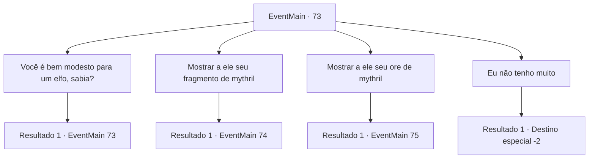

# Eventos principais · 73

[Índice da tabela](index.md) · [Índice geral](../index.md)

ID: `pt:EventMain:73` · Fonte: `EventMain4` · Versão: 1.2.47.

Mapeamento estático dos arquivos; a disponibilidade e a execução dependem do estado da run.

## Texto do evento

*Sem texto no arquivo.*

## Dados de entrada

```json
{
  "id": 73,
  "grade": 1,
  "normalGoal": "",
  "required": ""
}
```

## Mapa das escolhas



## Escolhas e resultados

### Escolha 1

Você é bem modesto para um elfo, sabia?

Requisitos e outros campos da escolha:

```json
{
  "required": "5_69_0"
}
```

#### Resultado 1.1

O elfo parece um pouco envergonhado pelo seu elogio. 

 "Bem, somos tão diversos quanto a sua espécie... Verdade seja dita, sou descendente de elfos e anões. O tipo que vocês chamam de dwelves."

 Ele luta com a pronúncia, duh-welves.

Continuação registrada: [Evento 73](0073.md) na mesma tabela.

```json
{
  "required": "",
  "chance": "1",
  "nextEvent": 73,
  "type": 2,
  "reward": "5_69_1"
}
```

### Escolha 2

Mostrar a ele seu fragmento de mythril

Requisitos e outros campos da escolha:

```json
{
  "required": "8_128_1"
}
```

#### Resultado 2.1

Ele examina o mythril enquanto escova a barba. 

 "Hum. Isso não é suficiente para uma nova arma, mas apenas o suficiente para revestir uma existente. Voc ~ e tem algum?"


Continuação registrada: [Evento 74](0074.md) na mesma tabela.

```json
{
  "required": "",
  "chance": "1",
  "nextEvent": 74,
  "type": 2,
  "reward": ""
}
```

### Escolha 3

Mostrar a ele seu ore de mythril

Requisitos e outros campos da escolha:

```json
{
  "required": "8_129_1"
}
```

#### Resultado 3.1

Ele examina o mythril enquanto escova a barba. 

 "Hum. Qualidade decente. O suficiente para forjar uma nova arma. Você tem alguma coisa em mente?"


Continuação registrada: [Evento 75](0075.md) na mesma tabela.

```json
{
  "required": "",
  "chance": "1",
  "nextEvent": 75,
  "type": 2,
  "reward": ""
}
```

### Escolha 4

Eu não tenho muito

Requisitos e outros campos da escolha:

```json
{
  "required": ""
}
```

#### Resultado 4.1

Você confessa que não tem nada com que o ferreiro possa trabalhar. Hundor cruza os braços e pensa um momento antes de falar. 

 "Bem, nesse caso, eu lhe darei algo em estoque."

 Ele diz enquanto desce as escadas.
 Momentos depois, ele ressurge com um pedaço de armadura de couro. 

 "Aqui, fiz isso para praticar curtimento de couro."

 Você pega a armadura e continua sua jornada.

Continuação registrada: [Destino especial `-2`](../destinos-especiais.md).

```json
{
  "required": "",
  "chance": "1",
  "nextEvent": -2,
  "type": 2,
  "reward": "3_31_1|0_2_1|5_72_2"
}
```

## Referências que chegam a este evento

- [Evento 72 · escolha 1 · resultado 1](0072.md#escolha-1)
- [Evento 73 · escolha 1 · resultado 1](0073.md#escolha-1)
