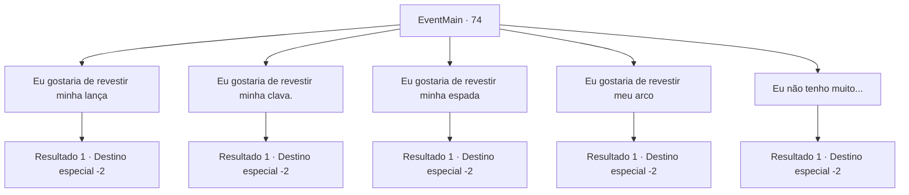

# Eventos principais · 74

[Índice da tabela](index.md) · [Índice geral](../index.md)

ID: `pt:EventMain:74` · Fonte: `EventMain4` · Versão: 1.2.47.

Mapeamento estático dos arquivos; a disponibilidade e a execução dependem do estado da run.

## Texto do evento

*Sem texto no arquivo.*

## Dados de entrada

```json
{
  "id": 74,
  "grade": 1,
  "normalGoal": "",
  "required": ""
}
```

## Mapa das escolhas



## Escolhas e resultados

### Escolha 1

Eu gostaria de revestir minha lança

Requisitos e outros campos da escolha:

```json
{
  "required": "8_58_1"
}
```

#### Resultado 1.1

Hundor pega sua arma e fragmento de mythril. Ele diz que levará alguns dias. Então ele desaparece em seu espaço de trabalho. Você decide passar um pouco de tempo na vila élfica. 

 Alguns dias depois, você visita Hundor. Ele orgulhosamente apresenta sua nova alabarda de mythril. 

 "Ninguém ousará desrespeitar essa beleza."

 Você pega a arma e continua sua jornada.

Continuação registrada: [Destino especial `-2`](../destinos-especiais.md).

```json
{
  "required": "",
  "chance": "1",
  "nextEvent": -2,
  "type": 2,
  "reward": "4_128_1|4_58_1|3_59_1|0_2_2|5_72_2"
}
```

### Escolha 2

Eu gostaria de revestir minha clava.

Requisitos e outros campos da escolha:

```json
{
  "required": "8_62_1"
}
```

#### Resultado 2.1

Hundor pega sua arma e fragmento de mythril. Ele diz que levará alguns dias. Então ele desaparece em seu espaço de trabalho. Você decide passar um pouco de tempo na vila élfica. 

 Alguns dias depois, você visita Hundor. Ele orgulhosamente apresenta sua nova maça de mythril. 

 "Ninguém ousará desrespeitar essa beleza."

 Você pega a arma e continua sua jornada.

Continuação registrada: [Destino especial `-2`](../destinos-especiais.md).

```json
{
  "required": "",
  "chance": "1",
  "nextEvent": -2,
  "type": 2,
  "reward": "4_128_1|4_62_1|3_63_1|0_2_2|5_72_2"
}
```

### Escolha 3

Eu gostaria de revestir minha espada

Requisitos e outros campos da escolha:

```json
{
  "required": "8_74_1"
}
```

#### Resultado 3.1

Hundor pega sua arma e fragmento de mythril. Ele diz que levará alguns dias. Então ele desaparece em seu espaço de trabalho. Você decide passar um pouco de tempo na vila élfica. 

 Alguns dias depois, você visita Hundor. Ele orgulhosamente apresenta sua nova espada de armamento de mythril. 

 "Ninguém ousará desrespeitar essa beleza."

 Você pega a arma e continua sua jornada.

Continuação registrada: [Destino especial `-2`](../destinos-especiais.md).

```json
{
  "required": "",
  "chance": "1",
  "nextEvent": -2,
  "type": 2,
  "reward": "4_128_1|4_74_1|3_75_1|0_2_2|5_72_2"
}
```

### Escolha 4

Eu gostaria de revestir meu arco

Requisitos e outros campos da escolha:

```json
{
  "required": "8_78_1"
}
```

#### Resultado 4.1

Hundor pega sua arma e fragmento de mythril. Ele diz que levará alguns dias. Então ele desaparece em seu espaço de trabalho. Você decide passar um pouco de tempo na vila élfica. 

 Alguns dias depois, você visita Hundor. Ele orgulhosamente apresenta seu novo arco de mythril. 

 "Ninguém ousará desrespeitar essa beleza."

 Você pega a arma e continua sua jornada.

Continuação registrada: [Destino especial `-2`](../destinos-especiais.md).

```json
{
  "required": "",
  "chance": "1",
  "nextEvent": -2,
  "type": 2,
  "reward": "4_128_1|4_78_1|3_79_1|0_2_2|5_72_2"
}
```

### Escolha 5

Eu não tenho muito...

Requisitos e outros campos da escolha:

```json
{
  "required": ""
}
```

#### Resultado 5.1

Você confessa que não tem nada com que o ferreiro possa trabalhar. Hundor cruza os braços e pensa por um momento antes de falar. 

 "Bem, nesse caso, eu lhe darei algo em estoque."

 Ele diz enquanto desce as escadas.
 Momentos depois, ele ressurge com um pedaço de armadura de couro. 

 "Aqui, fiz isso para praticar curtimento de couro."

 Você pega a armadura e continua sua jornada.

Continuação registrada: [Destino especial `-2`](../destinos-especiais.md).

```json
{
  "required": "",
  "chance": "1",
  "nextEvent": -2,
  "type": 2,
  "reward": "3_31_1|3_78_1|0_2_1|4_128_1|5_72_2"
}
```

## Referências que chegam a este evento

- [Evento 73 · escolha 2 · resultado 1](0073.md#escolha-2)
