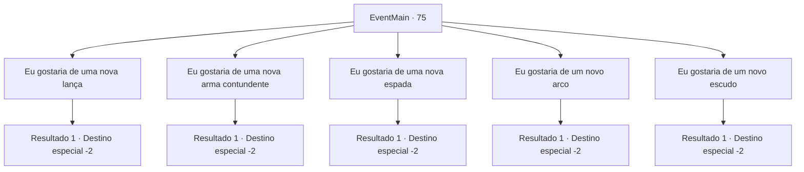

# Eventos principais · 75

[Índice da tabela](index.md) · [Índice geral](../index.md)

ID: `pt:EventMain:75` · Fonte: `EventMain4` · Versão: 1.2.47.

Mapeamento estático dos arquivos; a disponibilidade e a execução dependem do estado da run.

## Texto do evento

*Sem texto no arquivo.*

## Dados de entrada

```json
{
  "id": 75,
  "grade": 1,
  "normalGoal": "",
  "required": ""
}
```

## Mapa das escolhas



## Escolhas e resultados

### Escolha 1

Eu gostaria de uma nova lança

Requisitos e outros campos da escolha:

```json
{
  "required": ""
}
```

#### Resultado 1.1

Hundor leva seu minério de mythril para seu espaço de trabalho. Você decide passar um pouco de tempo na vila élfica. 

 Alguns dias depois, ele orgulhosamente apresenta sua nova alabarda de mythril. 

 "Ninguém ousará desrespeitar essa beleza."

 Você pega a arma e continua sua jornada.

Continuação registrada: [Destino especial `-2`](../destinos-especiais.md).

```json
{
  "required": "",
  "chance": "1",
  "nextEvent": -2,
  "type": 2,
  "reward": "4_129_1|3_59_1|0_2_2|5_72_2"
}
```

### Escolha 2

Eu gostaria de uma nova arma contundente

Requisitos e outros campos da escolha:

```json
{
  "required": ""
}
```

#### Resultado 2.1

Hundor leva seu minério de mythril para seu espaço de trabalho. Você decide passar um pouco de tempo na vila élfica. 

 Alguns dias depois, ele orgulhosamente apresenta sua nova maça de mythril. 

 "Ninguém ousará desrespeitar essa beleza."

 Você pega a arma e continua sua jornada.

Continuação registrada: [Destino especial `-2`](../destinos-especiais.md).

```json
{
  "required": "",
  "chance": "1",
  "nextEvent": -2,
  "type": 2,
  "reward": "4_129_1|3_63_1|0_2_2|5_72_2"
}
```

### Escolha 3

Eu gostaria de uma nova espada

Requisitos e outros campos da escolha:

```json
{
  "required": ""
}
```

#### Resultado 3.1

Hundor leva seu minério de mythril para seu espaço de trabalho. Você decide passar um pouco de tempo na vila élfica. 

 Alguns dias depois, ele orgulhosamente apresenta sua nova espada de armamento de mythril. 

 "Ninguém ousará desrespeitar essa beleza."

 Você pega a arma e continua sua jornada.

Continuação registrada: [Destino especial `-2`](../destinos-especiais.md).

```json
{
  "required": "",
  "chance": "1",
  "nextEvent": -2,
  "type": 2,
  "reward": "4_129_1|3_75_1|0_2_2|5_72_2"
}
```

### Escolha 4

Eu gostaria de um novo arco

Requisitos e outros campos da escolha:

```json
{
  "required": ""
}
```

#### Resultado 4.1

Hundor leva seu minério de mythril para seu espaço de trabalho. Você decide passar um pouco de tempo na vila élfica. 

 Alguns dias depois, ele orgulhosamente apresenta seu novo arco de mythril. 

 "Ninguém ousará desrespeitar essa beleza."

 Você pega a arma e continua sua jornada.

Continuação registrada: [Destino especial `-2`](../destinos-especiais.md).

```json
{
  "required": "",
  "chance": "1",
  "nextEvent": -2,
  "type": 2,
  "reward": "4_129_1|3_79_1|0_2_2|5_72_2"
}
```

### Escolha 5

Eu gostaria de um novo escudo

Requisitos e outros campos da escolha:

```json
{
  "required": ""
}
```

#### Resultado 5.1

Hundor leva seu minério de mythril para seu espaço de trabalho. Você decide passar um pouco de tempo na vila élfica. 

 Alguns dias depois, ele orgulhosamente apresenta seu novo broquel de mythril. 

 "Ninguém ousará desrespeitar essa beleza."

 Você pega a arma e continua sua jornada.

Continuação registrada: [Destino especial `-2`](../destinos-especiais.md).

```json
{
  "required": "",
  "chance": "1",
  "nextEvent": -2,
  "type": 2,
  "reward": "4_129_1|3_115_1|0_2_2|5_72_2"
}
```

## Referências que chegam a este evento

- [Evento 73 · escolha 3 · resultado 1](0073.md#escolha-3)
