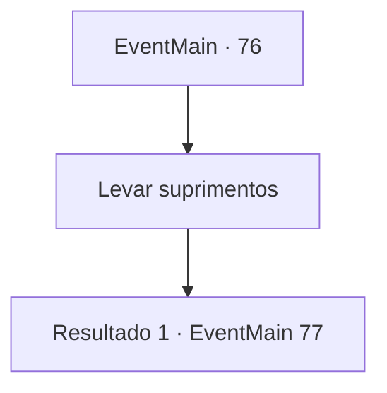

# Eventos principais · 76

[Índice da tabela](index.md) · [Índice geral](../index.md)

ID: `pt:EventMain:76` · Fonte: `EventMain4` · Versão: 1.2.47.

Mapeamento estático dos arquivos; a disponibilidade e a execução dependem do estado da run.

## Texto do evento

Você para em um acampamento dos pioneiros para comer uma tigela de ensopado. Nesse momento, um grupo de carruagens chega. As carruagens estão cheias de armas e armaduras. Um mensageiro desce de um dos cavalos. Ele pega um pergaminho e começa a ler. 

 "A-ham. Sua majestade lhe envia seus cumprimentos."

 Ele explica que o rei reconhece as dificuldades da fronteira, e que ele enviou esses suprimentos por preocupação. 

 "Preocupado meu rabo. Ele não deveria ter nos enviado aqui para morrer."

 alguém murmura, mas todos pegam os suprimentos de bom grado.

## Dados de entrada

```json
{
  "id": 76,
  "grade": 1,
  "normalGoal": "",
  "required": "13_0_5|1_2_50|5_73_1"
}
```

## Mapa das escolhas



## Escolhas e resultados

### Escolha 1

Levar suprimentos

Requisitos e outros campos da escolha:

```json
{
  "required": ""
}
```

#### Resultado 1.1

Você se alinha com os outros pioneiros na frente da carruagem. O fornecedor reconhece você e fala. 

 "Você deve ser {1}. Me siga."

 Ele leva você para uma carruagem separada dos outros. Então ele pergunta qual arma você gostaria.

Continuação registrada: [Evento 77](0077.md) na mesma tabela.

```json
{
  "required": "",
  "chance": "1",
  "nextEvent": 77,
  "type": 2,
  "reward": "5_73_2"
}
```

## Referências que chegam a este evento

Nenhum `nextEvent` positivo da mesma tabela aponta para este nó. Isso não prova que seja inacessível: sorteio e estado de história podem selecioná-lo.

