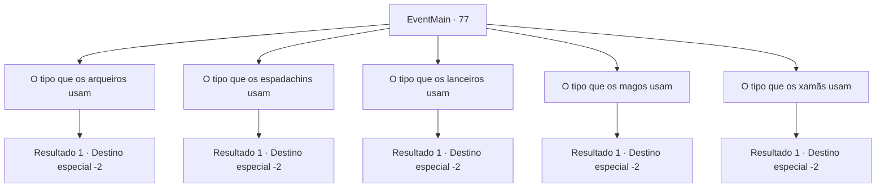

# Eventos principais · 77

[Índice da tabela](index.md) · [Índice geral](../index.md)

ID: `pt:EventMain:77` · Fonte: `EventMain4` · Versão: 1.2.47.

Mapeamento estático dos arquivos; a disponibilidade e a execução dependem do estado da run.

## Texto do evento

*Sem texto no arquivo.*

## Dados de entrada

```json
{
  "id": 77,
  "grade": 1,
  "normalGoal": "",
  "required": ""
}
```

## Mapa das escolhas



## Escolhas e resultados

### Escolha 1

O tipo que os arqueiros usam

Requisitos e outros campos da escolha:

```json
{
  "required": ""
}
```

#### Resultado 1.1

Você pede o equipamento dos arqueiros. O fornecedor lhe entrega um arco e uma armadura. 

 "Ai está. Agradecemos seus esforços aqui. A armadura deve ser de alta qualidade."

 Você pega seu novo equipamento e sai do acampamento.

Continuação registrada: [Destino especial `-2`](../destinos-especiais.md).

```json
{
  "required": "",
  "chance": "1",
  "nextEvent": -2,
  "type": 2,
  "reward": "3_78_1|3_84_1|0_2_1"
}
```

### Escolha 2

O tipo que os espadachins usam

Requisitos e outros campos da escolha:

```json
{
  "required": ""
}
```

#### Resultado 2.1

Você pede equipamento de espadachim. O fornecedor lhe entrega uma espada, um escudo e uma armadura. 

 "Ai está. Agradecemos seus esforços aqui. A armadura deve ser de alta qualidade."

 Você pega seu novo equipamento e sai do acampamento.

Continuação registrada: [Destino especial `-2`](../destinos-especiais.md).

```json
{
  "required": "",
  "chance": "1",
  "nextEvent": -2,
  "type": 2,
  "reward": "3_74_1|3_82_1|3_120_1|0_2_1"
}
```

### Escolha 3

O tipo que os lanceiros usam

Requisitos e outros campos da escolha:

```json
{
  "required": ""
}
```

#### Resultado 3.1

Você pede o equipamento dos lanceiros. O fornecedor lhe entrega uma alabarda e uma armadura. 

 "Ai está. Agradecemos seus esforços aqui. A armadura deve ser de alta qualidade."

 Você pega seu novo equipamento e sai do acampamento.

Continuação registrada: [Destino especial `-2`](../destinos-especiais.md).

```json
{
  "required": "",
  "chance": "1",
  "nextEvent": -2,
  "type": 2,
  "reward": "3_58_1|3_82_1|0_2_1"
}
```

### Escolha 4

O tipo que os magos usam

Requisitos e outros campos da escolha:

```json
{
  "required": ""
}
```

#### Resultado 4.1

Você pede o equipamento dos magos. O fornecedor lhe entrega uma varinha, um manto e um pequeno broquel. 

 "Ai está. Agradecemos seus esforços aqui. O manto deve ser de alta qualidade."

 Você pega seu novo equipamento e sai do acampamento.

Continuação registrada: [Destino especial `-2`](../destinos-especiais.md).

```json
{
  "required": "",
  "chance": "1",
  "nextEvent": -2,
  "type": 2,
  "reward": "3_86_1|3_88_1|3_114_1|0_2_1"
}
```

### Escolha 5

O tipo que os xamãs usam

Requisitos e outros campos da escolha:

```json
{
  "required": ""
}
```

#### Resultado 5.1

Você pede o equipamento dos xamãs. O fornecedor lhe entrega um amuleto, um manto e um pequeno broquel. 

 "Ai está. Agradecemos seus esforços aqui. A armadura deve ser de alta qualidade."

 Você e um novo equipamento e saia do acampamento.

Continuação registrada: [Destino especial `-2`](../destinos-especiais.md).

```json
{
  "required": "",
  "chance": "1",
  "nextEvent": -2,
  "type": 2,
  "reward": "3_86_1|3_70_1|3_114_1|0_2_1"
}
```

## Referências que chegam a este evento

- [Evento 76 · escolha 1 · resultado 1](0076.md#escolha-1)
