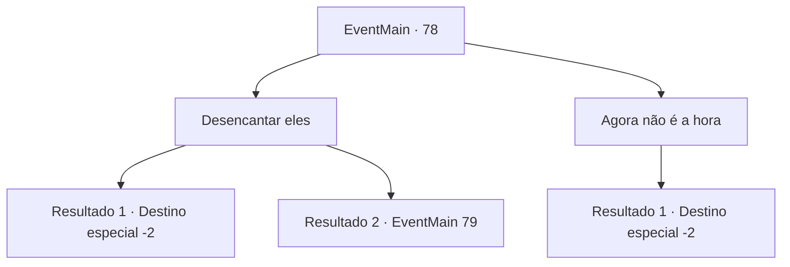

# Eventos principais · 78

[Índice da tabela](index.md) · [Índice geral](../index.md)

ID: `pt:EventMain:78` · Fonte: `EventMain4` · Versão: 1.2.47.

Mapeamento estático dos arquivos; a disponibilidade e a execução dependem do estado da run.

## Texto do evento

Você está passando por uma pequena vila, quando você percebe que todos estão orando constantemente. Você percebe que algo está errado e começa a observá-los. Eles não comem nem dormem, e ficam murmurando as palavras 'Halad é o único sagrado'. O nome 'Halad' desperta sua raiva. Ela é aquela que roubou o livro proibido e deixou todo mundo pensar que você o roubou.

## Dados de entrada

```json
{
  "id": 78,
  "grade": 1,
  "normalGoal": "",
  "required": "13_1_0|1_2_5"
}
```

## Mapa das escolhas



## Escolhas e resultados

### Escolha 1

Desencantar eles

Requisitos e outros campos da escolha:

```json
{
  "required": ""
}
```

#### Resultado 1.1

Você decide libertar os aldeões. Mas a magia de Halad é muito sofisticada para você desfazer. Você se sente amargo quando se afasta. Você não pode nem mesmo superar Halad, muito menos se tornar um grande Mago. Você precisa de um professor.

Continuação registrada: [Destino especial `-2`](../destinos-especiais.md).

```json
{
  "required": "",
  "chance": "9",
  "nextEvent": -2,
  "type": 1,
  "reward": "0_2_1|13_1_1"
}
```

#### Resultado 1.2

Você analisa e desfaz com sucesso a magia de Halad. As pessoas despertam como se de um sonho. 

 "O que aconteceu...?"

 Através do murmúrio confuso você ouve uma voz familiar. 

 "Você está no meu caminho de novo, falhou um."

 Halad aparece do nada e se aproxima de você. Ela olha para você como se tivesse visto uma barata.

Continuação registrada: [Evento 79](0079.md) na mesma tabela.

```json
{
  "required": "",
  "chance": "1|0_7_1",
  "nextEvent": 79,
  "type": 0,
  "reward": "0_3_2|0_2_2"
}
```

### Escolha 2

Agora não é a hora

Requisitos e outros campos da escolha:

```json
{
  "required": ""
}
```

#### Resultado 2.1

Você olha para as pessoas que sofreram lavagem cerebral de Halad, decidindo que algum dia você as libertará. No entanto, você acredita que ainda não é a hora e acha que precisa de um tutor para melhorar ainda mais suas habilidades.

Continuação registrada: [Destino especial `-2`](../destinos-especiais.md).

```json
{
  "required": "",
  "chance": "1",
  "nextEvent": -2,
  "type": 2,
  "reward": "0_2_1|13_1_1"
}
```

## Referências que chegam a este evento

Nenhum `nextEvent` positivo da mesma tabela aponta para este nó. Isso não prova que seja inacessível: sorteio e estado de história podem selecioná-lo.

