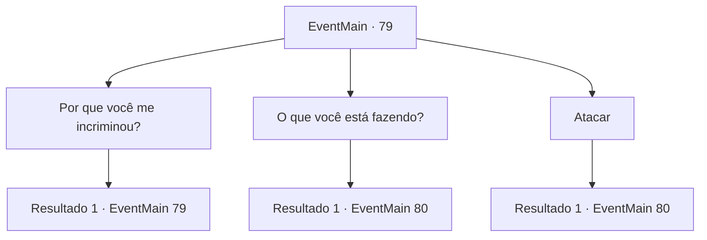

# Eventos principais · 79

[Índice da tabela](index.md) · [Índice geral](../index.md)

ID: `pt:EventMain:79` · Fonte: `EventMain4` · Versão: 1.2.47.

Mapeamento estático dos arquivos; a disponibilidade e a execução dependem do estado da run.

## Texto do evento

*Sem texto no arquivo.*

## Dados de entrada

```json
{
  "id": 79,
  "grade": 1,
  "normalGoal": "",
  "required": ""
}
```

## Mapa das escolhas



## Escolhas e resultados

### Escolha 1

Por que você me incriminou?

Requisitos e outros campos da escolha:

```json
{
  "required": "5_62_0"
}
```

#### Resultado 1.1

Você se lembra do que aconteceu. Halad sempre foi uma ótima aluna, e todo mundo a invejava. Um dia, você a testemunhou roubando o livro proibido. Você tentou impedi-la e isso provocou uma discussão, depois disso Halad disse aos professores que você tentou roubar o livro. 

 "Huh... eu acho que você realmente é uma pessoa simples para me perguntar por que depois de todos esses anos."

 Ela boceja como se sua pergunta fosse mesquinha e insignificante.

Continuação registrada: [Evento 79](0079.md) na mesma tabela.

```json
{
  "required": "",
  "chance": "1",
  "nextEvent": 79,
  "type": 2,
  "reward": "5_62_1"
}
```

### Escolha 2

O que você está fazendo?

Requisitos e outros campos da escolha:

```json
{
  "required": ""
}
```

#### Resultado 2.1

Você pergunta a Halad por que ela encantou os aldeões. Ela faz uma pergunta em troca. 

 "E você acha que vai entender se eu te contar?"

 E com isso, ela saca sua varinha.

Continuação registrada: [Evento 80](0080.md) na mesma tabela.

```json
{
  "required": "",
  "chance": "1",
  "nextEvent": 80,
  "type": 2,
  "reward": "6_0_76",
  "place": 4
}
```

### Escolha 3

Atacar

Requisitos e outros campos da escolha:

```json
{
  "required": ""
}
```

#### Resultado 3.1

Palavras parecem fúteis. Você golpeia Halad o mais forte que pode.

Continuação registrada: [Evento 80](0080.md) na mesma tabela.

```json
{
  "required": "",
  "chance": "1",
  "nextEvent": 80,
  "type": 2,
  "reward": "6_0_76",
  "place": 4
}
```

## Referências que chegam a este evento

- [Evento 78 · escolha 1 · resultado 2](0078.md#escolha-1)
- [Evento 79 · escolha 1 · resultado 1](0079.md#escolha-1)
