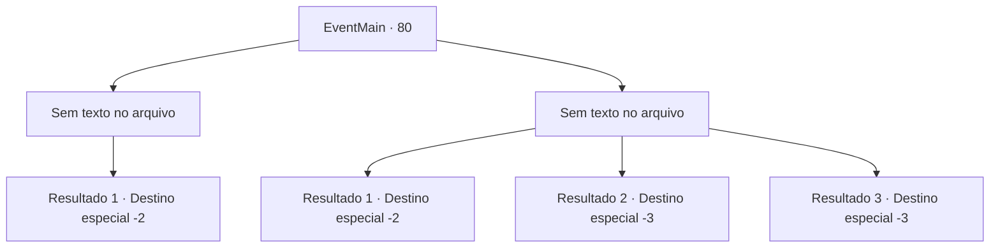

# Eventos principais · 80

[Índice da tabela](index.md) · [Índice geral](../index.md)

ID: `pt:EventMain:80` · Fonte: `EventMain4` · Versão: 1.2.47.

Mapeamento estático dos arquivos; a disponibilidade e a execução dependem do estado da run.

## Texto do evento

*Sem texto no arquivo.*

## Dados de entrada

```json
{
  "id": 80,
  "grade": 1,
  "normalGoal": "",
  "required": ""
}
```

## Mapa das escolhas



## Escolhas e resultados

### Escolha 1

*Sem texto no arquivo; o papel dessa opção depende da interface do jogo.*

Requisitos e outros campos da escolha:

```json
{
  "required": ""
}
```

#### Resultado 1.1

Halad se torna um borrão antes de desaparecer. Então você a ouve por trás. 

 "Vejo que você treinou... mas por absolutamente nada. Patético como você ainda não consegue distinguir ilusões."

 Você se vira, mas redemoinhos de preto cobrem seus olhos. 

 Você não tem ideia de quanto tempo se passou. 
 Quando você abre os olhos, ela se foi. Você se sente melhor quando se afasta. Você não pode nem mesmo superar Halad, muito menos se tornar um grande Mago. Você precisa de um professor.

Continuação registrada: [Destino especial `-2`](../destinos-especiais.md).

```json
{
  "required": "",
  "chance": "1",
  "nextEvent": -2,
  "type": 2,
  "reward": "13_1_1"
}
```

### Escolha 2

*Sem texto no arquivo; o papel dessa opção depende da interface do jogo.*

Requisitos e outros campos da escolha:

```json
{
  "required": ""
}
```

#### Resultado 2.1

Você se sente desaparecendo. Ela suspira um suspiro lamentável. 

 "Eu vou poupá-lo por causa dos velhos tempos. Mas entre no meu caminho de novo e eu vou te fazer em pedaços."

 Você não tem ideia de quanto tempo se passou. 
 Quando você abre os olhos, ela se foi. Você se sente melhor quando se afasta. Você não pode nem mesmo superar Halad, muito menos se tornar um grande mago. Você precisa de um professor.

Continuação registrada: [Destino especial `-2`](../destinos-especiais.md).

```json
{
  "required": "1_0_2|1_1_2",
  "chance": "1",
  "nextEvent": -2,
  "type": 2,
  "reward": "0_0_-1|0_1_-1|0_2_1|13_1_1"
}
```

#### Resultado 2.2

Você se sente desaparecendo. Ela solta um suspiro lamentável. 

 "Opa, foi mal. Desculpe, eu nunca quis te matar."

 E com isso, o mundo inteiro fica escuro.

Continuação registrada: [Destino especial `-3`](../destinos-especiais.md).

```json
{
  "required": "2_0_2",
  "chance": "1",
  "nextEvent": -3,
  "type": 2,
  "reward": "0_0_-1|0_1_-1"
}
```

#### Resultado 2.3

Você se sente desaparecendo. Ela solta um suspiro lamentável. 

 "Opa, foi mal. Desculpe, eu nunca quis te matar."

 E com isso, o mundo inteiro fica escuro.

Continuação registrada: [Destino especial `-3`](../destinos-especiais.md).

```json
{
  "required": "2_1_2",
  "chance": "1",
  "nextEvent": -3,
  "type": 2,
  "reward": "0_0_-1|0_1_-1"
}
```

## Referências que chegam a este evento

- [Evento 79 · escolha 2 · resultado 1](0079.md#escolha-2)
- [Evento 79 · escolha 3 · resultado 1](0079.md#escolha-3)
