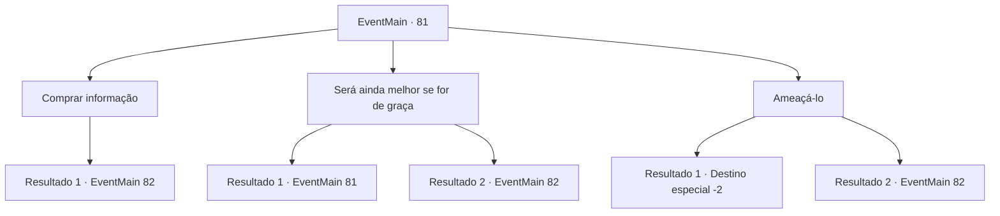

# Eventos principais · 81

[Índice da tabela](index.md) · [Índice geral](../index.md)

ID: `pt:EventMain:81` · Fonte: `EventMain4` · Versão: 1.2.47.

Mapeamento estático dos arquivos; a disponibilidade e a execução dependem do estado da run.

## Texto do evento

Você procura rumores sobre grandes magos. Um dia, você conhece um velho que se oferece para lhe contar uma história. Ele acrescenta que valerá a pena cada moeda e pisca.

## Dados de entrada

```json
{
  "id": 81,
  "grade": 1,
  "normalGoal": "",
  "required": "13_1_1|1_2_20|5_63_0"
}
```

## Mapa das escolhas



## Escolhas e resultados

### Escolha 1

Comprar informação

Requisitos e outros campos da escolha:

```json
{
  "required": "1_4_5"
}
```

#### Resultado 1.1

O velho fala sobre a 'Bruxa Índigo'. Ela era uma maga competente que aconselhava reis, mas está atualmente fugindo depois de não conseguir assassinar um deles. O homem para para olhar ao redor antes de falar novamente em voz baixa. 

 "Ouvi dizer que ela mora em um chalé em algum lugar na Floresta 'Dorione'... bem ali."

 Ele aponta vagamente para o centro da floresta. Você agradece ao velho e vai para a floresta.

Continuação registrada: [Evento 82](0082.md) na mesma tabela.

```json
{
  "required": "",
  "chance": "1",
  "nextEvent": 82,
  "type": 2,
  "reward": "0_4_-5|5_63_2"
}
```

### Escolha 2

Será ainda melhor se for de graça

Requisitos e outros campos da escolha:

```json
{
  "required": "5_63_0"
}
```

#### Resultado 2.1

O velho balança a cabeça. Ele não vai dar nada a menos que você pague.

Continuação registrada: [Evento 81](0081.md) na mesma tabela.

```json
{
  "required": "",
  "chance": "9",
  "nextEvent": 81,
  "type": 1,
  "reward": "5_63_1"
}
```

#### Resultado 2.2

Você, de alguma forma, consegue que o velho fale sem pagá-lo. Ele fala sobre a 'Bruxa Índigo'. Ela era uma maga competente que aconselhava reis, mas está atualmente fugindo depois de não conseguir assassinar um deles. O homem para para olhar ao redor antes de falar novamente em voz baixa. 

 "Ouvi dizer que ela mora em um chalé em algum lugar na Floresta 'Dorione'... bem ali."

 Ele aponta vagamente para o centro da floresta. Você agradece ao velho e vai para a floresta.

Continuação registrada: [Evento 82](0082.md) na mesma tabela.

```json
{
  "required": "",
  "chance": "1|0_7_1",
  "nextEvent": 82,
  "type": 0,
  "reward": "5_63_2"
}
```

### Escolha 3

Ameaçá-lo

Requisitos e outros campos da escolha:

```json
{
  "required": ""
}
```

#### Resultado 3.1

Você ameaça o velho, mas ele não pisca. Então ele te chama de rude, faz as malas e vai embora.

Continuação registrada: [Destino especial `-2`](../destinos-especiais.md).

```json
{
  "required": "",
  "chance": "8",
  "nextEvent": -2,
  "type": 1,
  "reward": "13_1_10|5_63_9|5_6_3"
}
```

#### Resultado 3.2

Você, de alguma forma, consegue que o velho fale sem pagá-lo. Ele fala sobre a 'Bruxa Índigo'. Ela era uma maga competente que aconselhava reis, mas está atualmente fugindo depois de não conseguir assassinar um deles. O homem para para olhar ao redor antes de falar novamente em voz baixa. 

 "Ouvi dizer que ela mora em um chalé em algum lugar na Floresta 'Dorione'... bem ali."

 Ele aponta vagamente para o centro da floresta. Você agradece ao velho e vai para a floresta.

Continuação registrada: [Evento 82](0082.md) na mesma tabela.

```json
{
  "required": "",
  "chance": "1|0_12_1",
  "nextEvent": 82,
  "type": 0,
  "reward": "0_3_-2|5_63_2"
}
```

## Referências que chegam a este evento

- [Evento 81 · escolha 2 · resultado 1](0081.md#escolha-2)
