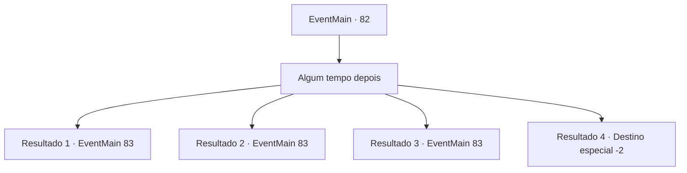

# Eventos principais · 82

[Índice da tabela](index.md) · [Índice geral](../index.md)

ID: `pt:EventMain:82` · Fonte: `EventMain4` · Versão: 1.2.47.

Mapeamento estático dos arquivos; a disponibilidade e a execução dependem do estado da run.

## Texto do evento

*Sem texto no arquivo.*

## Dados de entrada

```json
{
  "id": 82,
  "grade": 1,
  "normalGoal": "",
  "required": ""
}
```

## Mapa das escolhas



## Escolhas e resultados

### Escolha 1

Algum tempo depois

Requisitos e outros campos da escolha:

```json
{
  "required": ""
}
```

#### Resultado 1.1

Você vagueia pela floresta, tentando encontrar vestígios de mana. Mas os traços giram em círculos e você sempre acaba voltando para onde começou. Você quase desiste e cai no chão. Nesse momento, você ouve a voz de uma mulher em sua cabeça. 

 "Quem é Você? Você está me procurando, mas não está com a polícia... o que você quer?"


Continuação registrada: [Evento 83](0083.md) na mesma tabela.

```json
{
  "required": "5_6_0",
  "chance": "1",
  "nextEvent": 83,
  "type": 2,
  "reward": ""
}
```

#### Resultado 1.2

Você entra na floresta da bruxa e imediatamente ouve uma voz familiar em sua cabeça. 

 "Bem bem. Olha quem está aqui. O que te traz até aqui?"

 Ela é a mulher que você salvou perto do depósito de lixo. Ela gentilmente leva você para sua casa. Você encontra e entra na casa dela. Ela te oferece chá quente e te pede. 

 "Então, como posso ajudá-lo?"


Continuação registrada: [Evento 83](0083.md) na mesma tabela.

```json
{
  "required": "5_6_4",
  "chance": "1",
  "nextEvent": 83,
  "type": 2,
  "reward": ""
}
```

#### Resultado 1.3

Você entra na floresta da bruxa e imediatamente ouve uma voz familiar em sua cabeça. 

 "Bem bem. Olha quem está aqui. O que te traz até aqui?"

 Ela é a mulher que você salvou perto do depósito de lixo. Ela gentilmente leva você para sua casa. Você encontra e entra na casa dela. Ela te oferece chá quente e te pede. 

 "Então, como posso ajudá-lo?"


Continuação registrada: [Evento 83](0083.md) na mesma tabela.

```json
{
  "required": "5_6_2",
  "chance": "1",
  "nextEvent": 83,
  "type": 2,
  "reward": ""
}
```

#### Resultado 1.4

Você vagueia por 'Dorione Forest' por horas procurando pela bruxa. Por fim, você chega ao que costumava ser uma casa de campo. Esta deve ter sido a oficina da bruxa, mas é um silêncio mortal. Então você se lembra da velha que estava escondida no depósito de lixo. Talvez ela fosse a Bruxa Índigo. Você não tem escolha a não ser procurar outro professor.

Continuação registrada: [Destino especial `-2`](../destinos-especiais.md).

```json
{
  "required": "5_6_3",
  "chance": "1",
  "nextEvent": -2,
  "type": 2,
  "reward": "13_1_10"
}
```

## Referências que chegam a este evento

- [Evento 81 · escolha 1 · resultado 1](0081.md#escolha-1)
- [Evento 81 · escolha 2 · resultado 2](0081.md#escolha-2)
- [Evento 81 · escolha 3 · resultado 2](0081.md#escolha-3)
