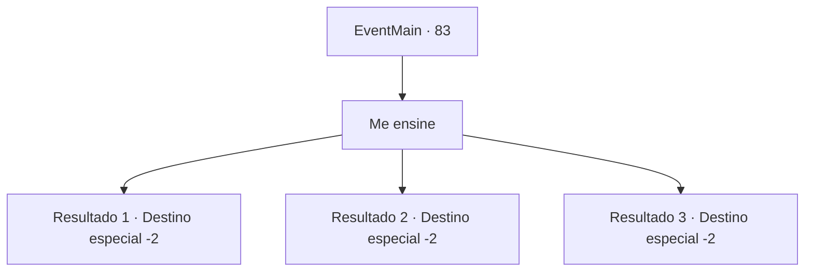

# Eventos principais · 83

[Índice da tabela](index.md) · [Índice geral](../index.md)

ID: `pt:EventMain:83` · Fonte: `EventMain4` · Versão: 1.2.47.

Mapeamento estático dos arquivos; a disponibilidade e a execução dependem do estado da run.

## Texto do evento

*Sem texto no arquivo.*

## Dados de entrada

```json
{
  "id": 83,
  "grade": 1,
  "normalGoal": "",
  "required": ""
}
```

## Mapa das escolhas



## Escolhas e resultados

### Escolha 1

Me ensine

Requisitos e outros campos da escolha:

```json
{
  "required": ""
}
```

#### Resultado 1.1

A bruxa ri ao responder. 

 "Claro, eu vou te ensinar. Mas somente se você passar neste teste."

 Seu primeiro teste exige que você traga um tesouro antigo do Deserto de Hela. Você sai para provar a si mesmo.

Continuação registrada: [Destino especial `-2`](../destinos-especiais.md).

```json
{
  "required": "5_6_0",
  "chance": "1",
  "nextEvent": -2,
  "type": 2,
  "reward": "0_2_1|13_1_4"
}
```

#### Resultado 1.2

Ela toma um gole de chá e olha em seus olhos. 

 "...Você deve estar desesperado. Mas ninguém se torna meu discípulo sem antes se tornar digno, nem mesmo meu salvador."

 Seu primeiro teste exige que você traga um tesouro antigo do Deserto de Hela. Ela avisa antes de você sair. 

 "O túmulo é guardado por uma esfinge. Boa sorte."

 Você sai para provar a si mesmo.

Continuação registrada: [Destino especial `-2`](../destinos-especiais.md).

```json
{
  "required": "5_6_4",
  "chance": "1",
  "nextEvent": -2,
  "type": 2,
  "reward": "0_2_1|13_1_4|5_6_9"
}
```

#### Resultado 1.3

Ela toma um gole de chá e olha em seus olhos. 

 "...Você deve estar desesperado. Mas ninguém se torna meu discípulo sem antes se tornar digno, nem mesmo meu salvador."

 Seu primeiro teste exige que você traga um tesouro antigo do Deserto de Hela. Ela avisa antes de você sair. 

 "O túmulo é guardado por uma esfinge. Boa sorte."

 Você sai para provar a si mesmo.

Continuação registrada: [Destino especial `-2`](../destinos-especiais.md).

```json
{
  "required": "5_6_2",
  "chance": "1",
  "nextEvent": -2,
  "type": 2,
  "reward": "0_2_1|13_1_4|5_6_9"
}
```

## Referências que chegam a este evento

- [Evento 82 · escolha 1 · resultado 1](0082.md#escolha-1)
- [Evento 82 · escolha 1 · resultado 2](0082.md#escolha-1)
- [Evento 82 · escolha 1 · resultado 3](0082.md#escolha-1)
