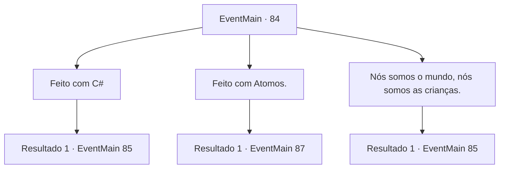

# Eventos principais · 84

[Índice da tabela](index.md) · [Índice geral](../index.md)

ID: `pt:EventMain:84` · Fonte: `EventMain4` · Versão: 1.2.47.

Mapeamento estático dos arquivos; a disponibilidade e a execução dependem do estado da run.

## Texto do evento

Você chega ao Deserto de Hela, assim como a Bruxa Índigo pediu. O local é quase tão antigo quanto o próprio tempo, e as tempestades de areia ocultaram os detalhes. Você enfrenta a esfinge que guarda sua entrada. |drawing_spinx| Ele olha para você com olhos opacos e cansados. Então ele boceja e começa a falar lentamente. 

 "Resolva este enigma e eu lhe darei entrada. Caso contrário, eu vou comer você. Então o enigma é... do que é feito este mundo?"


## Dados de entrada

```json
{
  "id": 84,
  "grade": 1,
  "normalGoal": "",
  "required": "13_1_4|1_2_30"
}
```

## Mapa das escolhas



## Escolhas e resultados

### Escolha 1

Feito com C#

Requisitos e outros campos da escolha:

```json
{
  "required": ""
}
```

#### Resultado 1.1

A esfinge franze a testa. Então mostra os dentes e rosna para você. 

 "Eu desprezo o seu tipo... o tipo nervoso, meta."

 Ele estende suas garras e continua. 

 "Resposta errada. Hora de morrer!"


Continuação registrada: [Evento 85](0085.md) na mesma tabela.

```json
{
  "required": "",
  "chance": "1",
  "nextEvent": 85,
  "type": 2,
  "reward": ""
}
```

### Escolha 2

Feito com Atomos.

Requisitos e outros campos da escolha:

```json
{
  "required": ""
}
```

#### Resultado 2.1

A esfinge se afasta. 

 "Grande resposta... ótima resposta de fato. Tudo é feito de átomos. E um átomo é composto de um núcleo consistindo de prótons, nêutrons e elétrons que orbitam o núcleo. Mas eu discordo. Você está livre para ir."

 Os portões empoeirados se abrem lentamente e você entra. Pedras luminescentes laranja brilham nas paredes, iluminando o interior. Você continua descendo até ver uma queda de areia. Você vê uma placa de pedra redonda gravada com um emblema na parede próxima.

Continuação registrada: [Evento 87](0087.md) na mesma tabela.

```json
{
  "required": "",
  "chance": "1",
  "nextEvent": 87,
  "type": 2,
  "reward": "0_2_2"
}
```

### Escolha 3

Nós somos o mundo, nós somos as crianças.

Requisitos e outros campos da escolha:

```json
{
  "required": ""
}
```

#### Resultado 3.1

A esfinge franze a testa. Então mostra os dentes e rosna para você. 

 "Você está falando bobagem."

 Ele estende suas garras e continua. 

 "Resposta errada. Hora de morrer!"


Continuação registrada: [Evento 85](0085.md) na mesma tabela.

```json
{
  "required": "",
  "chance": "1",
  "nextEvent": 85,
  "type": 2,
  "reward": ""
}
```

## Referências que chegam a este evento

Nenhum `nextEvent` positivo da mesma tabela aponta para este nó. Isso não prova que seja inacessível: sorteio e estado de história podem selecioná-lo.

