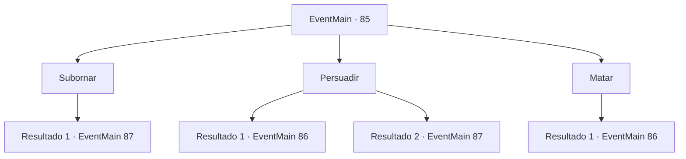

# Eventos principais · 85

[Índice da tabela](index.md) · [Índice geral](../index.md)

ID: `pt:EventMain:85` · Fonte: `EventMain4` · Versão: 1.2.47.

Mapeamento estático dos arquivos; a disponibilidade e a execução dependem do estado da run.

## Texto do evento

*Sem texto no arquivo.*

## Dados de entrada

```json
{
  "id": 85,
  "grade": 1,
  "normalGoal": "",
  "required": ""
}
```

## Mapa das escolhas



## Escolhas e resultados

### Escolha 1

Subornar

Requisitos e outros campos da escolha:

```json
{
  "required": "1_4_100"
}
```

#### Resultado 1.1

Você entrega à esfinge uma bolsa pesada de moedas de ouro. Ele hesita um momento, depois pega a bolsa e fecha os olhos. No fundo, não quer lutar. 

 Os portões empoeirados se abrem lentamente e você entra. Pedras luminescentes laranja brilham nas paredes, iluminando o interior. Você continua descendo até ver uma queda de areia. Você vê uma placa de pedra redonda gravada com um emblema na parede próxima.

Continuação registrada: [Evento 87](0087.md) na mesma tabela.

```json
{
  "required": "",
  "chance": "1",
  "nextEvent": 87,
  "type": 2,
  "reward": "0_2_2|0_4_-100"
}
```

### Escolha 2

Persuadir

Requisitos e outros campos da escolha:

```json
{
  "required": "1_7_6|1_7_9"
}
```

#### Resultado 2.1

Você tenta convencer a esfinge, mas é uma criatura teimosa. Ele abre suas asas, sobe para o céu e desce sobre você.

Continuação registrada: [Evento 86](0086.md) na mesma tabela.

```json
{
  "required": "",
  "chance": "9",
  "nextEvent": 86,
  "type": 1,
  "reward": "6_0_73",
  "place": 5
}
```

#### Resultado 2.2

Você convenceu com sucesso a esfinge. No fundo, não quer lutar. 

 "Huh... Você tem uma língua de prata. Multar. Você está livre para ir."

 Os portões empoeirados se abrem lentamente e você entra. Pedras luminescentes laranja brilham nas paredes, iluminando o interior. Você continua descendo até ver uma queda de areia. Você vê uma placa de pedra redonda gravada com um emblema na parede próxima.

Continuação registrada: [Evento 87](0087.md) na mesma tabela.

```json
{
  "required": "",
  "chance": "1|0_7_1",
  "nextEvent": 87,
  "type": 0,
  "reward": ""
}
```

### Escolha 3

Matar

Requisitos e outros campos da escolha:

```json
{
  "required": ""
}
```

#### Resultado 3.1

Você saca sua arma e luta contra a esfinge. Ele abre suas asas, sobe para o céu e desce sobre você.

Continuação registrada: [Evento 86](0086.md) na mesma tabela.

```json
{
  "required": "",
  "chance": "1",
  "nextEvent": 86,
  "type": 2,
  "reward": "6_0_73",
  "place": 5
}
```

## Referências que chegam a este evento

- [Evento 84 · escolha 1 · resultado 1](0084.md#escolha-1)
- [Evento 84 · escolha 3 · resultado 1](0084.md#escolha-3)
