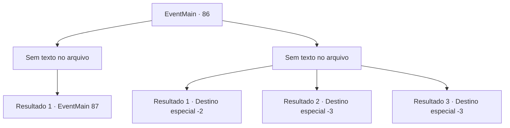

# Eventos principais · 86

[Índice da tabela](index.md) · [Índice geral](../index.md)

ID: `pt:EventMain:86` · Fonte: `EventMain4` · Versão: 1.2.47.

Mapeamento estático dos arquivos; a disponibilidade e a execução dependem do estado da run.

## Texto do evento

*Sem texto no arquivo.*

## Dados de entrada

```json
{
  "id": 86,
  "grade": 1,
  "normalGoal": "",
  "required": ""
}
```

## Mapa das escolhas



## Escolhas e resultados

### Escolha 1

*Sem texto no arquivo; o papel dessa opção depende da interface do jogo.*

Requisitos e outros campos da escolha:

```json
{
  "required": ""
}
```

#### Resultado 1.1

Você domina a esfinge e ela voa para longe. Os portões empoeirados se abrem lentamente e você entra. Pedras luminescentes laranja brilham nas paredes, iluminando o interior. Você continua descendo até ver uma queda de areia. Você vê uma placa de pedra redonda gravada com um emblema na parede próxima.

Continuação registrada: [Evento 87](0087.md) na mesma tabela.

```json
{
  "required": "",
  "chance": "1",
  "nextEvent": 87,
  "type": 2,
  "reward": ""
}
```

### Escolha 2

*Sem texto no arquivo; o papel dessa opção depende da interface do jogo.*

Requisitos e outros campos da escolha:

```json
{
  "required": ""
}
```

#### Resultado 2.1

A esfinge te corta todo com suas garras e dentes, e você mal consegue escapar. Ele não persegue você.

Continuação registrada: [Destino especial `-2`](../destinos-especiais.md).

```json
{
  "required": "1_0_2|1_1_2",
  "chance": "1",
  "nextEvent": -2,
  "type": 2,
  "reward": "0_0_-1|0_1_-1|0_2_1|13_1_5"
}
```

#### Resultado 2.2

A esfinge te despedaça com suas garras e dentes.

Continuação registrada: [Destino especial `-3`](../destinos-especiais.md).

```json
{
  "required": "2_0_2",
  "chance": "1",
  "nextEvent": -3,
  "type": 2,
  "reward": "0_0_-1|0_1_-1"
}
```

#### Resultado 2.3

A esfinge te despedaça com suas garras e dentes.

Continuação registrada: [Destino especial `-3`](../destinos-especiais.md).

```json
{
  "required": "2_1_2",
  "chance": "1",
  "nextEvent": -3,
  "type": 2,
  "reward": "0_0_-1|0_1_-1"
}
```

## Referências que chegam a este evento

- [Evento 85 · escolha 2 · resultado 1](0085.md#escolha-2)
- [Evento 85 · escolha 3 · resultado 1](0085.md#escolha-3)
