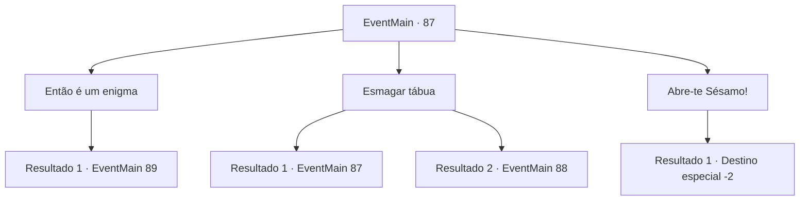

# Eventos principais · 87

[Índice da tabela](index.md) · [Índice geral](../index.md)

ID: `pt:EventMain:87` · Fonte: `EventMain4` · Versão: 1.2.47.

Mapeamento estático dos arquivos; a disponibilidade e a execução dependem do estado da run.

## Texto do evento

*Sem texto no arquivo.*

## Dados de entrada

```json
{
  "id": 87,
  "grade": 1,
  "normalGoal": "",
  "required": ""
}
```

## Mapa das escolhas



## Escolhas e resultados

### Escolha 1

Então é um enigma

Requisitos e outros campos da escolha:

```json
{
  "required": ""
}
```

#### Resultado 1.1

Você examina a tabuinha redonda. Tem um círculo no meio, que é cercado por duas bordas móveis, cada uma com um sol e uma lua desenhados na superfície. No centro do círculo está a palavra 'eclipse'.

Continuação registrada: [Evento 89](0089.md) na mesma tabela.

```json
{
  "required": "",
  "chance": "1",
  "nextEvent": 89,
  "type": 2,
  "reward": ""
}
```

### Escolha 2

Esmagar tábua

Requisitos e outros campos da escolha:

```json
{
  "required": "5_64_0"
}
```

#### Resultado 2.1

Você bate nq tábua o mais forte que pode, mas nada acontece. Deve haver alguma outra maneira.

Continuação registrada: [Evento 87](0087.md) na mesma tabela.

```json
{
  "required": "",
  "chance": "14",
  "nextEvent": 87,
  "type": 1,
  "reward": "5_64_1"
}
```

#### Resultado 2.2

Você bate na tábua o mais forte que pode, e ele se desfaz em pedaços. Em seguida, fora da queda de areia caminha Golem gigante. 

 "Intruso identificado. Iniciando a rescisão."

 Suas juntas de pedra rangem umas contra as outras enquanto ele balança o punho em você.

Continuação registrada: [Evento 88](0088.md) na mesma tabela.

```json
{
  "required": "",
  "chance": "1|0_5_1",
  "nextEvent": 88,
  "type": 0,
  "reward": "6_0_15",
  "place": 7
}
```

### Escolha 3

Abre-te Sésamo!

Requisitos e outros campos da escolha:

```json
{
  "required": "1_7_12"
}
```

#### Resultado 3.1

Você grita um feitiço que você se lembra de um conto de fadas infantil. Para sua grande surpresa, a tábua gira no lugar com um clique. A cascata de areia se abre e você vê o que está por trás dela. |drawing_insidePyramid| É uma grande sala feita de rochas cortadas com precisão, e uma tabuleta de pedra preta está no topo de um pódio de granito no fundo. Você pega a tabuleta e sai do local.

Continuação registrada: [Destino especial `-2`](../destinos-especiais.md).

```json
{
  "required": "",
  "chance": "1",
  "nextEvent": -2,
  "type": 2,
  "reward": "3_132_1|0_2_2|13_1_5"
}
```

## Referências que chegam a este evento

- [Evento 84 · escolha 2 · resultado 1](0084.md#escolha-2)
- [Evento 85 · escolha 1 · resultado 1](0085.md#escolha-1)
- [Evento 85 · escolha 2 · resultado 2](0085.md#escolha-2)
- [Evento 86 · escolha 1 · resultado 1](0086.md#escolha-1)
- [Evento 87 · escolha 2 · resultado 1](0087.md#escolha-2)
