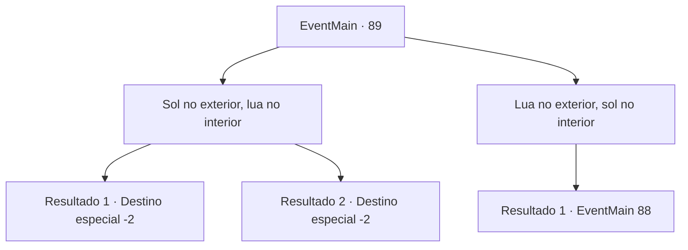

# Eventos principais · 89

[Índice da tabela](index.md) · [Índice geral](../index.md)

ID: `pt:EventMain:89` · Fonte: `EventMain4` · Versão: 1.2.47.

Mapeamento estático dos arquivos; a disponibilidade e a execução dependem do estado da run.

## Texto do evento

*Sem texto no arquivo.*

## Dados de entrada

```json
{
  "id": 89,
  "grade": 1,
  "normalGoal": "",
  "required": ""
}
```

## Mapa das escolhas



## Escolhas e resultados

### Escolha 1

Sol no exterior, lua no interior

Requisitos e outros campos da escolha:

```json
{
  "required": ""
}
```

#### Resultado 1.1

Você alinha o sol na borda externa, a lua na borda interna e o círculo no meio. A tábua gira no lugar com um clique. A cascata de areia se abre e você vê o que está por trás dela. |drawing_insidePyramid| É uma grande sala feita de rochas cortadas com precisão, e uma tabuleta de pedra preta está no topo de um pódio de granito no fundo. Você pega a tabuleta e sai do local.

Continuação registrada: [Destino especial `-2`](../destinos-especiais.md).

```json
{
  "required": "",
  "chance": "1",
  "nextEvent": -2,
  "type": 2,
  "reward": "3_132_1|0_2_2|13_1_5"
}
```

#### Resultado 1.2

Você alinha o sol na borda externa, a lua na borda interna e o círculo no meio. A tábua gira no lugar com um clique. A cascata de areia se abre e você vê o que está por trás dela. |drawing_insidePyramid| É uma grande sala feita de rochas cortadas com precisão, e uma tabuleta de pedra preta fica no topo de um pódio de granito no fundo.
 A tabuinha é intitulada 'Tabela de Sakara' e está gravada com uma escrita antiga e obsoleta. Você pega a tábua e sai do local.

Continuação registrada: [Destino especial `-2`](../destinos-especiais.md).

```json
{
  "required": "1_7_15",
  "chance": "1",
  "nextEvent": -2,
  "type": 2,
  "reward": "3_132_1|0_2_2|13_1_5"
}
```

### Escolha 2

Lua no exterior, sol no interior

Requisitos e outros campos da escolha:

```json
{
  "required": ""
}
```

#### Resultado 2.1

Você alinha a lua na borda externa, o sol na borda interna e o círculo no meio. Então, fora da queda de areia, sai um golem gigante. 

 "Intruso identificado. Iniciando a rescisão."

 Suas juntas de pedra rangem umas contra as outras enquanto ele balança o punho em você.

Continuação registrada: [Evento 88](0088.md) na mesma tabela.

```json
{
  "required": "",
  "chance": "1",
  "nextEvent": 88,
  "type": 2,
  "reward": "6_0_15",
  "place": 7
}
```

## Referências que chegam a este evento

- [Evento 87 · escolha 1 · resultado 1](0087.md#escolha-1)
