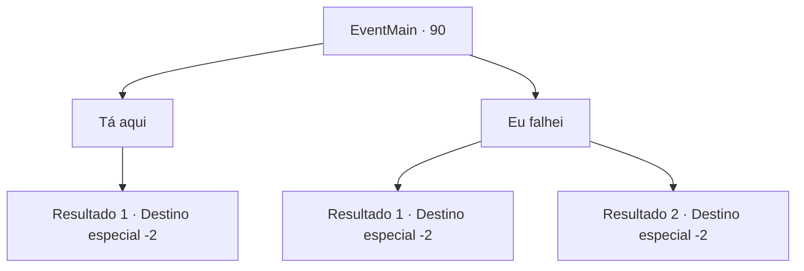

# Eventos principais · 90

[Índice da tabela](index.md) · [Índice geral](../index.md)

ID: `pt:EventMain:90` · Fonte: `EventMain4` · Versão: 1.2.47.

Mapeamento estático dos arquivos; a disponibilidade e a execução dependem do estado da run.

## Texto do evento

Você faz o seu caminho de volta para a Bruxa Índigo. Ela te pede o tesouro assim que te vê

## Dados de entrada

```json
{
  "id": 90,
  "grade": 1,
  "normalGoal": "",
  "required": "13_1_5|1_2_40"
}
```

## Mapa das escolhas



## Escolhas e resultados

### Escolha 1

Tá aqui

Requisitos e outros campos da escolha:

```json
{
  "required": "8_132_1"
}
```

#### Resultado 1.1

Você entrega a ela a tábua de pedra. Ela o pega com cuidado e desaparece em seu quarto. Momentos depois, ela volta e fala. 

 "Bom. Próximo teste: preciso que você extraia veneno da hidra que vive nos pântanos de Nera."

 Ela enfia a mão em sua pequena bolsa e tira uma pequena poção. Não se parece com nenhuma outra poção que você já viu antes. 

 "Isto virá a calhar. Agora vá embora."

 Ela gesticula para você sair, e você vai para os pântanos.

Continuação registrada: [Destino especial `-2`](../destinos-especiais.md).

```json
{
  "required": "",
  "chance": "1",
  "nextEvent": -2,
  "type": 2,
  "reward": "0_2_1|3_130_1|13_1_6|4_132_1"
}
```

### Escolha 2

Eu falhei

Requisitos e outros campos da escolha:

```json
{
  "required": ""
}
```

#### Resultado 2.1

Ela parece um pouco decepcionada. 

 "Multar. Este é um pouco mais complicado, mas espero que você faça um trabalho melhor desta vez. Eu preciso que você extraia veneno da hidra que vive nos pântanos de Nera."

 Ela enfia a mão em sua pequena bolsa e tira uma pequena poção. Não se parece com nenhuma outra poção que você já viu antes. 

 "Isto virá a calhar. Agora vá embora."

 Ela gesticula para você sair, e você vai para os pântanos.

Continuação registrada: [Destino especial `-2`](../destinos-especiais.md).

```json
{
  "required": "5_6_4",
  "chance": "1",
  "nextEvent": -2,
  "type": 2,
  "reward": "0_2_1|3_130_1|13_1_6|5_89_1"
}
```

#### Resultado 2.2

Ela não esconde sua decepção ao te expulsar. 

 "Você não pode se tornar meu discípulo depois de falhar em algo tão fácil."

 Você não tem escolha a não ser procurar outra pessoa.

Continuação registrada: [Destino especial `-2`](../destinos-especiais.md).

```json
{
  "required": "18_6_4",
  "chance": "1",
  "nextEvent": -2,
  "type": 2,
  "reward": "0_2_1|13_1_10"
}
```

## Referências que chegam a este evento

Nenhum `nextEvent` positivo da mesma tabela aponta para este nó. Isso não prova que seja inacessível: sorteio e estado de história podem selecioná-lo.

