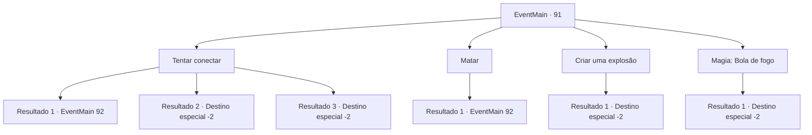

# Eventos principais · 91

[Índice da tabela](index.md) · [Índice geral](../index.md)

ID: `pt:EventMain:91` · Fonte: `EventMain4` · Versão: 1.2.47.

Mapeamento estático dos arquivos; a disponibilidade e a execução dependem do estado da run.

## Texto do evento

Você chega aos pântanos de Nera e descobre que está densamente coberto de árvores. O chão abaixo é uma mistura de lama, água e algas, e cheira como se algo tivesse morrido ali. Você avança, um passo de cada vez. 

 Algumas horas depois, você chega ao território da hidra no centro dos pântanos. As 5 cabeças localizam você e a criatura sobe lentamente. |drawing_hydra|

## Dados de entrada

```json
{
  "id": 91,
  "grade": 1,
  "normalGoal": "",
  "required": "13_1_6|1_2_60"
}
```

## Mapa das escolhas



## Escolhas e resultados

### Escolha 1

Tentar conectar

Requisitos e outros campos da escolha:

```json
{
  "required": ""
}
```

#### Resultado 1.1

Você olha em seus muitos olhos enquanto cuidadosamente estende sua mão. Mas seus esforços se mostram inteiramente fúteis. A hidra silva de raiva, arreganha os dentes e ataca você.

Continuação registrada: [Evento 92](0092.md) na mesma tabela.

```json
{
  "required": "10_98_1",
  "chance": "20",
  "nextEvent": 92,
  "type": 1,
  "reward": "6_3_74",
  "place": 1
}
```

#### Resultado 1.2

Você olha em seus muitos olhos enquanto cuidadosamente estende sua mão. A hidra silenciosamente permite que você se aproxime dela. Você acaricia cada uma de suas cabeças. Então você extrai seu veneno e volta para a bruxa.

Continuação registrada: [Destino especial `-2`](../destinos-especiais.md).

```json
{
  "required": "10_98_1",
  "chance": "1|0_12_1",
  "nextEvent": -2,
  "type": 0,
  "reward": "13_1_7|3_133_1|0_2_2"
}
```

#### Resultado 1.3

Você tira 'Olho de Fafnir'. A hidra dá uma olhada nele e se contorce violentamente antes de entrar em colapso. Todas as suas cabeças caem inconscientes e você extrai seu veneno com facilidade.

Continuação registrada: [Destino especial `-2`](../destinos-especiais.md).

```json
{
  "required": "8_98_1",
  "chance": "1",
  "nextEvent": -2,
  "type": 2,
  "reward": "13_1_7|3_133_1|0_2_2"
}
```

### Escolha 2

Matar

Requisitos e outros campos da escolha:

```json
{
  "required": ""
}
```

#### Resultado 2.1

Você pega sua arma e ataca a hidra. Ele mostra os dentes e começa a cercar você com suas muitas cabeças.

Continuação registrada: [Evento 92](0092.md) na mesma tabela.

```json
{
  "required": "",
  "chance": "1",
  "nextEvent": 92,
  "type": 2,
  "reward": "6_0_74",
  "place": 1
}
```

### Escolha 3

Criar uma explosão

Requisitos e outros campos da escolha:

```json
{
  "required": "8_47_1|1_7_10"
}
```

#### Resultado 3.1

Você percebe o que é todo o cheiro e vapor dos pântanos. A podridão dentro está emitindo algum tipo de gás. Você também percebe que a menor faísca pode iluminar todo o lugar e dar um passo para trás. Você acende sua cesta de fósforos e joga na hidra. Isso cria uma explosão enorme. |drawing_hydraExplosion| O impacto varre você e toda a área para longe. Você volta para verificar e encontra a hidra queimada. Você extrai seu veneno e volta para a bruxa.

Continuação registrada: [Destino especial `-2`](../destinos-especiais.md).

```json
{
  "required": "",
  "chance": "1",
  "nextEvent": -2,
  "type": 2,
  "reward": "13_1_7|4_47_1|3_133_1|0_2_2"
}
```

### Escolha 4

Magia: Bola de fogo

Requisitos e outros campos da escolha:

```json
{
  "required": "20_0_2|1_1_2"
}
```

#### Resultado 4.1

Você percebe o que é todo o cheiro e vapor dos pântanos. A podridão dentro está emitindo algum tipo de gás. Você também percebe que a menor faísca pode iluminar todo o lugar, e dê um passo para trás antes de atirar uma bola de fogo nos pântanos. Isso cria uma explosão enorme. |drawing_hydraExplosion| O impacto varre você e toda a área para longe. Você volta para verificar e encontra a hidra queimada. Você extrai seu veneno e volta para a bruxa.

Continuação registrada: [Destino especial `-2`](../destinos-especiais.md).

```json
{
  "required": "",
  "chance": "1",
  "nextEvent": -2,
  "type": 2,
  "reward": "13_1_7|3_133_1|0_2_2|0_1_-1"
}
```

## Referências que chegam a este evento

Nenhum `nextEvent` positivo da mesma tabela aponta para este nó. Isso não prova que seja inacessível: sorteio e estado de história podem selecioná-lo.

