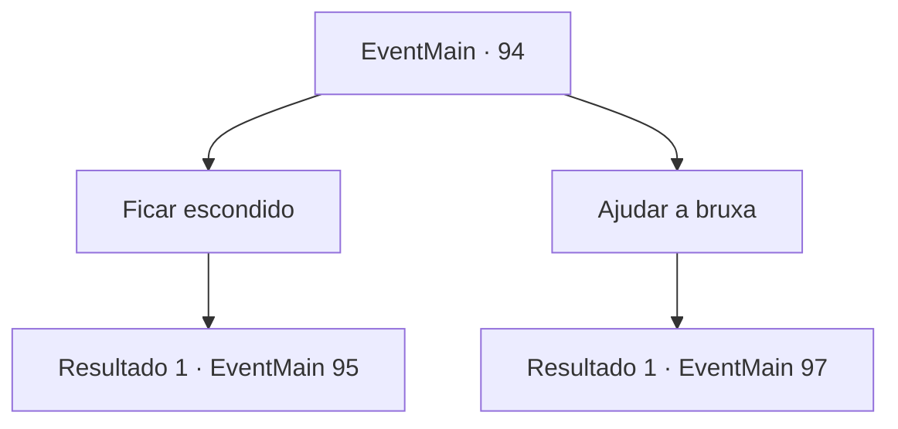

# Eventos principais · 94

[Índice da tabela](index.md) · [Índice geral](../index.md)

ID: `pt:EventMain:94` · Fonte: `EventMain4` · Versão: 1.2.47.

Mapeamento estático dos arquivos; a disponibilidade e a execução dependem do estado da run.

## Texto do evento

Você volta para a Forest de Dorione para encontrar a bruxa. Mas você sente que as coisas são diferentes quando chega. Você não consegue mais sentir a mana dela, que antes cercava toda a floresta. Você acha isso sinistro e rapidamente vai para a casa dela. |drawing_witchhunt| Lá, você encontra a bruxa lutando contra vários caçadores de recompensas e um carrasco. Eles não parecem notar você.

## Dados de entrada

```json
{
  "id": 94,
  "grade": 1,
  "normalGoal": "",
  "required": "13_1_7|1_2_70"
}
```

## Mapa das escolhas



## Escolhas e resultados

### Escolha 1

Ficar escondido

Requisitos e outros campos da escolha:

```json
{
  "required": ""
}
```

#### Resultado 1.1

Você decide ficar escondido.
 Após alguns minutos de combate acalorado, a floresta recupera sua atmosfera calma. 

 "Ufa... esses idiotas pensaram que eu ia cair como da última vez."

 A Bruxa Índigo suspira enquanto sacode detritos de suas mãos. Seus inimigos estão parados ao redor dela, seus rostos azuis. Ela olha na direção que você está se escondendo e fala. 

 "Saia, pequenino, está tudo feito agora. Você me deu o que eu pedi?"


Continuação registrada: [Evento 95](0095.md) na mesma tabela.

```json
{
  "required": "",
  "chance": "1",
  "nextEvent": 95,
  "type": 2,
  "reward": "0_2_1|5_88_1"
}
```

### Escolha 2

Ajudar a bruxa

Requisitos e outros campos da escolha:

```json
{
  "required": ""
}
```

#### Resultado 2.1

Você ataca um dos caçadores de recompensas. Ele não está ciente de sua presença, e é pego de surpresa. 

 "O-O que! Caramba!"


Continuação registrada: [Evento 97](0097.md) na mesma tabela.

```json
{
  "required": "",
  "chance": "1",
  "nextEvent": 97,
  "type": 2,
  "reward": "6_2_25|5_88_1",
  "place": 1
}
```

## Referências que chegam a este evento

Nenhum `nextEvent` positivo da mesma tabela aponta para este nó. Isso não prova que seja inacessível: sorteio e estado de história podem selecioná-lo.

