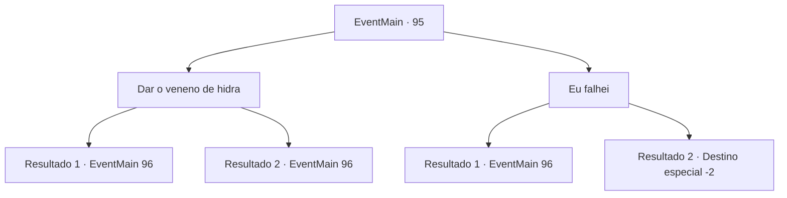

# Eventos principais · 95

[Índice da tabela](index.md) · [Índice geral](../index.md)

ID: `pt:EventMain:95` · Fonte: `EventMain4` · Versão: 1.2.47.

Mapeamento estático dos arquivos; a disponibilidade e a execução dependem do estado da run.

## Texto do evento

*Sem texto no arquivo.*

## Dados de entrada

```json
{
  "id": 95,
  "grade": 1,
  "normalGoal": "",
  "required": ""
}
```

## Mapa das escolhas



## Escolhas e resultados

### Escolha 1

Dar o veneno de hidra

Requisitos e outros campos da escolha:

```json
{
  "required": "8_133_1"
}
```

#### Resultado 1.1

Você entrega a ela a garrafa contendo o veneno da hidra. Ela dá uma olhada e desaparece na casa com um sorriso satisfeito. Você espera lá fora. 

 Momentos depois, ela sai de seu quarto e pergunta a você. 

 "Agora, por que eu deveria levá-lo como meu discípulo?"


Continuação registrada: [Evento 96](0096.md) na mesma tabela.

```json
{
  "required": "18_89_1",
  "chance": "1",
  "nextEvent": 96,
  "type": 2,
  "reward": "4_133_1"
}
```

#### Resultado 1.2

Você entrega a ela a garrafa contendo o veneno da hidra. 

 "Ah... então você conseguiu desta vez."

 Ela dá uma olhada e desaparece na casa com um sorriso satisfeito. Você espera lá fora. 

 Momentos depois, ela sai de seu quarto e pergunta a você. 

 "Agora, por que eu deveria levá-lo como meu discípulo?"


Continuação registrada: [Evento 96](0096.md) na mesma tabela.

```json
{
  "required": "5_89_1",
  "chance": "1",
  "nextEvent": 96,
  "type": 2,
  "reward": "4_133_1"
}
```

### Escolha 2

Eu falhei

Requisitos e outros campos da escolha:

```json
{
  "required": "10_133_1"
}
```

#### Resultado 2.1

Você admite que não conseguiu obter o veneno da hidra. A bruxa enrola o cabelo com o dedo enquanto fala. 

 "Bem, bem... eu pensei que seria uma brisa para você, mas aparentemente não."

 Ela para para pensar antes de continuar. 

 "Mas já que você teve sucesso em sua última missão, eu vou te dar mais uma chance. Explique-me por que devo aceitá-lo como discípulo."


Continuação registrada: [Evento 96](0096.md) na mesma tabela.

```json
{
  "required": "18_89_1",
  "chance": "1",
  "nextEvent": 96,
  "type": 2,
  "reward": "5_90_1"
}
```

#### Resultado 2.2

Você admite que não conseguiu obter o veneno da hidra. A bruxa enrola o cabelo com o dedo enquanto fala. 

 "Bem, bem... Achei que seria fácil para você, mas aparentemente não. Me desculpe, eu não posso te ensinar neste estado."

 Ela volta para sua casa, deixando você parado lá. Você não tem escolha a não ser procurar outro professor.

Continuação registrada: [Destino especial `-2`](../destinos-especiais.md).

```json
{
  "required": "5_89_1",
  "chance": "1",
  "nextEvent": -2,
  "type": 2,
  "reward": "13_1_10|0_2_1"
}
```

## Referências que chegam a este evento

- [Evento 94 · escolha 1 · resultado 1](0094.md#escolha-1)
- [Evento 97 · escolha 1 · resultado 1](0097.md#escolha-1)
- [Evento 97 · escolha 2 · resultado 1](0097.md#escolha-2)
- [Evento 207 · escolha 1 · resultado 1](0207.md#escolha-1)
