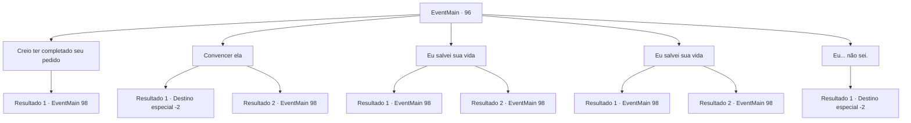

# Eventos principais · 96

[Índice da tabela](index.md) · [Índice geral](../index.md)

ID: `pt:EventMain:96` · Fonte: `EventMain4` · Versão: 1.2.47.

Mapeamento estático dos arquivos; a disponibilidade e a execução dependem do estado da run.

## Texto do evento

*Sem texto no arquivo.*

## Dados de entrada

```json
{
  "id": 96,
  "grade": 1,
  "normalGoal": "",
  "required": ""
}
```

## Mapa das escolhas



## Escolhas e resultados

### Escolha 1

Creio ter completado seu pedido

Requisitos e outros campos da escolha:

```json
{
  "required": "18_89_1|18_90_1"
}
```

#### Resultado 1.1

Você afirma ter feito tudo o que a bruxa pediu, e que ela é obrigada a acolhê-lo. Ela assente e responde. 

 "Você tem razão. Eu só queria ver se você não era um daqueles idiotas que não sabem o que querem."

 Ela se apresenta como 'Terria the Indigo'. Você se apresenta a ela em troca, e ela exige que você comece a treinar imediatamente.

Continuação registrada: [Evento 98](0098.md) na mesma tabela.

```json
{
  "required": "",
  "chance": "1",
  "nextEvent": 98,
  "type": 2,
  "reward": ""
}
```

### Escolha 2

Convencer ela

Requisitos e outros campos da escolha:

```json
{
  "required": "5_90_1"
}
```

#### Resultado 2.1

Você está envergonhado com a pergunta dela e não consegue responder. Ela parece desapontada enquanto fala. 

 "Você não pode nem responder a esta pergunta simples? Muito decepcionante, pequena."

 Ela se recusa a aceitar você como aprendiz e desaparece em sua casa. Você não tem escolha a não ser procurar outro professor.

Continuação registrada: [Destino especial `-2`](../destinos-especiais.md).

```json
{
  "required": "",
  "chance": "10",
  "nextEvent": -2,
  "type": 1,
  "reward": "13_1_10|0_2_1"
}
```

#### Resultado 2.2

Você afirma que arriscou sua vida para completar as missões da bruxa, independentemente de quão bem-sucedido você foi, e que você merece pelo menos metade do crédito por ter sucesso em um. 

 "Tudo bem... tudo bem. Eu vou te ensinar."

 Ela se apresenta como 'Terria the Indigo'. Você se apresenta a ela em troca, e ela exige que você comece a treinar imediatamente.

Continuação registrada: [Evento 98](0098.md) na mesma tabela.

```json
{
  "required": "",
  "chance": "1|0_7_1",
  "nextEvent": 98,
  "type": 0,
  "reward": ""
}
```

### Escolha 3

Eu salvei sua vida

Requisitos e outros campos da escolha:

```json
{
  "required": "5_6_2"
}
```

#### Resultado 3.1

Você afirma que arriscou sua vida para completar as missões da bruxa, independentemente de quão bem-sucedido você foi, e lembrá-la de que ela lhe deve a vida. Ela franze a testa um pouco, mas aceita. 

 "Tudo bem... tudo bem. Eu vou te ensinar."

 Ela se apresenta como 'Terria the Indigo'. Você se apresenta a ela em troca, e ela exige que você comece a treinar imediatamente.

Continuação registrada: [Evento 98](0098.md) na mesma tabela.

```json
{
  "required": "5_89_1",
  "chance": "1",
  "nextEvent": 98,
  "type": 2,
  "reward": ""
}
```

#### Resultado 3.2

Você afirma que arriscou sua vida para completar as missões da bruxa, independentemente de quão bem-sucedido você foi, e lembrá-la de que ela lhe deve a vida. Ela franze a testa um pouco, mas aceita. 

 "Tudo bem... tudo bem. Eu vou te ensinar."

 Ela se apresenta como 'Terria the Indigo'. Você se apresenta a ela em troca, e ela exige que você comece a treinar imediatamente.

Continuação registrada: [Evento 98](0098.md) na mesma tabela.

```json
{
  "required": "5_90_1",
  "chance": "1",
  "nextEvent": 98,
  "type": 2,
  "reward": ""
}
```

### Escolha 4

Eu salvei sua vida

Requisitos e outros campos da escolha:

```json
{
  "required": "5_6_4"
}
```

#### Resultado 4.1

Você afirma que arriscou sua vida para completar as missões da bruxa, independentemente de quão bem-sucedido você foi, e lembrou-lhe que ela lhe deve sua vida. 

 "Tudo bem... tudo bem. Eu vou te ensinar."

 Ela se apresenta como 'Terria the Indigo'. Você se apresenta a ela em troca, e ela exige que você comece a treinar imediatamente.

Continuação registrada: [Evento 98](0098.md) na mesma tabela.

```json
{
  "required": "5_89_1",
  "chance": "1",
  "nextEvent": 98,
  "type": 2,
  "reward": ""
}
```

#### Resultado 4.2

Você afirma que arriscou sua vida para completar as missões da bruxa, independentemente de quão bem-sucedido você foi, e lembrou-lhe que ela lhe deve sua vida. 

 "Tudo bem... tudo bem. Eu vou te ensinar."

 Ela se apresenta como 'Terria the Indigo'. Você se apresenta a ela em troca, e ela exige que você comece a treinar imediatamente.

Continuação registrada: [Evento 98](0098.md) na mesma tabela.

```json
{
  "required": "5_90_1",
  "chance": "1",
  "nextEvent": 98,
  "type": 2,
  "reward": ""
}
```

### Escolha 5

Eu... não sei.

Requisitos e outros campos da escolha:

```json
{
  "required": "2_7_6"
}
```

#### Resultado 5.1

Você está envergonhado com a pergunta dela e não consegue responder. Ela parece desapontada enquanto fala. 

 "Você não pode nem responder a esta pergunta simples? Muito decepcionante, pequena."

 Ela se recusa a aceitar você como aprendiz e desaparece em sua casa. Você não tem escolha a não ser procurar outro professor.

Continuação registrada: [Destino especial `-2`](../destinos-especiais.md).

```json
{
  "required": "",
  "chance": "1",
  "nextEvent": -2,
  "type": 2,
  "reward": "13_1_10|0_2_1"
}
```

## Referências que chegam a este evento

- [Evento 95 · escolha 1 · resultado 1](0095.md#escolha-1)
- [Evento 95 · escolha 1 · resultado 2](0095.md#escolha-1)
- [Evento 95 · escolha 2 · resultado 1](0095.md#escolha-2)
