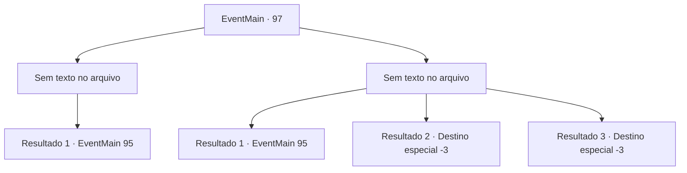

# Eventos principais · 97

[Índice da tabela](index.md) · [Índice geral](../index.md)

ID: `pt:EventMain:97` · Fonte: `EventMain4` · Versão: 1.2.47.

Mapeamento estático dos arquivos; a disponibilidade e a execução dependem do estado da run.

## Texto do evento

*Sem texto no arquivo.*

## Dados de entrada

```json
{
  "id": 97,
  "grade": 1,
  "normalGoal": "",
  "required": ""
}
```

## Mapa das escolhas



## Escolhas e resultados

### Escolha 1

*Sem texto no arquivo; o papel dessa opção depende da interface do jogo.*

Requisitos e outros campos da escolha:

```json
{
  "required": ""
}
```

#### Resultado 1.1

Você consegue derrotar um dos caçadores de recompensas enquanto a bruxa destrói o resto deles e o portador da lei. Ela lhe dá um sorriso. 

 "Você não precisava, mas obrigado. Você conseguiu o que eu pedi?"


Continuação registrada: [Evento 95](0095.md) na mesma tabela.

```json
{
  "required": "",
  "chance": "1",
  "nextEvent": 95,
  "type": 2,
  "reward": ""
}
```

### Escolha 2

*Sem texto no arquivo; o papel dessa opção depende da interface do jogo.*

Requisitos e outros campos da escolha:

```json
{
  "required": ""
}
```

#### Resultado 2.1

O caçador de recompensas te deixa inconsciente. Assim que ele tenta esfaquear você na garganta, algo o atinge no lado e o manda voando. A bruxa lhe dá um sorriso. 

 "Você não precisava, mas obrigado. Você conseguiu o que eu pedi?"


Continuação registrada: [Evento 95](0095.md) na mesma tabela.

```json
{
  "required": "1_0_2|1_1_2",
  "chance": "1",
  "nextEvent": 95,
  "type": 2,
  "reward": "0_0_-1|0_1_-1|0_2_1"
}
```

#### Resultado 2.2

O caçador de recompensas te deixa inconsciente.

Continuação registrada: [Destino especial `-3`](../destinos-especiais.md).

```json
{
  "required": "2_0_2",
  "chance": "1",
  "nextEvent": -3,
  "type": 2,
  "reward": "0_0_-1|0_1_-1"
}
```

#### Resultado 2.3

O caçador de recompensas te deixa inconsciente.

Continuação registrada: [Destino especial `-3`](../destinos-especiais.md).

```json
{
  "required": "2_1_2",
  "chance": "1",
  "nextEvent": -3,
  "type": 2,
  "reward": "0_0_-1|0_1_-1"
}
```

## Referências que chegam a este evento

- [Evento 94 · escolha 2 · resultado 1](0094.md#escolha-2)
- [Evento 207 · escolha 2 · resultado 1](0207.md#escolha-2)
