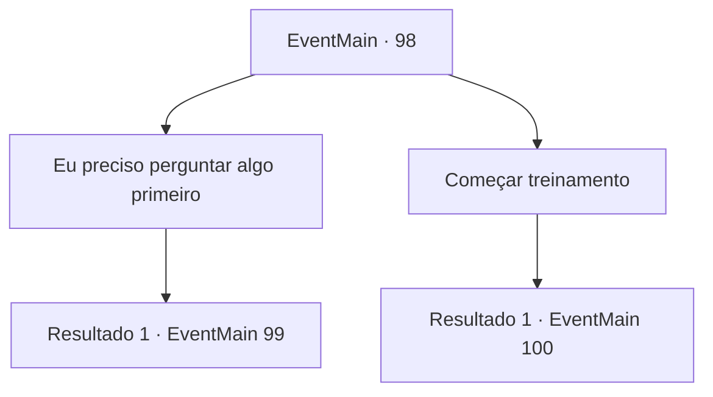

# Eventos principais · 98

[Índice da tabela](index.md) · [Índice geral](../index.md)

ID: `pt:EventMain:98` · Fonte: `EventMain4` · Versão: 1.2.47.

Mapeamento estático dos arquivos; a disponibilidade e a execução dependem do estado da run.

## Texto do evento

*Sem texto no arquivo.*

## Dados de entrada

```json
{
  "id": 98,
  "grade": 1,
  "normalGoal": "",
  "required": ""
}
```

## Mapa das escolhas



## Escolhas e resultados

### Escolha 1

Eu preciso perguntar algo primeiro

Requisitos e outros campos da escolha:

```json
{
  "required": ""
}
```

#### Resultado 1.1

Você decide fazer algumas perguntas a Terria. Ela parece um pouco confusa antes de assentir. 

 "O que você quer saber, pequena?"


Continuação registrada: [Evento 99](0099.md) na mesma tabela.

```json
{
  "required": "",
  "chance": "1",
  "nextEvent": 99,
  "type": 2,
  "reward": ""
}
```

### Escolha 2

Começar treinamento

Requisitos e outros campos da escolha:

```json
{
  "required": ""
}
```

#### Resultado 2.1

Você se torna aprendiz de Terria. Ela ri e avisa que o treinamento será duro. Ela entra em sua oficina e você a segue para dentro.

Continuação registrada: [Evento 100](0100.md) na mesma tabela.

```json
{
  "required": "",
  "chance": "1",
  "nextEvent": 100,
  "type": 2,
  "reward": ""
}
```

## Referências que chegam a este evento

- [Evento 96 · escolha 1 · resultado 1](0096.md#escolha-1)
- [Evento 96 · escolha 2 · resultado 2](0096.md#escolha-2)
- [Evento 96 · escolha 3 · resultado 1](0096.md#escolha-3)
- [Evento 96 · escolha 3 · resultado 2](0096.md#escolha-3)
- [Evento 96 · escolha 4 · resultado 1](0096.md#escolha-4)
- [Evento 96 · escolha 4 · resultado 2](0096.md#escolha-4)
