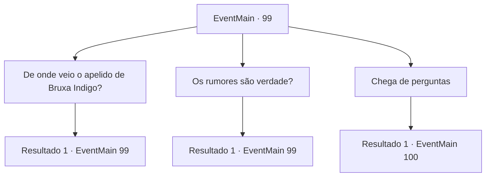

# Eventos principais · 99

[Índice da tabela](index.md) · [Índice geral](../index.md)

ID: `pt:EventMain:99` · Fonte: `EventMain4` · Versão: 1.2.47.

Mapeamento estático dos arquivos; a disponibilidade e a execução dependem do estado da run.

## Texto do evento

*Sem texto no arquivo.*

## Dados de entrada

```json
{
  "id": 99,
  "grade": 1,
  "normalGoal": "",
  "required": ""
}
```

## Mapa das escolhas



## Escolhas e resultados

### Escolha 1

De onde veio o apelido de Bruxa Indigo?

Requisitos e outros campos da escolha:

```json
{
  "required": "5_65_0"
}
```

#### Resultado 1.1

Você pergunta a Terria por que ela é chamada de 'Bruxa índigo'. Ela mexe no vestido enquanto responde. 

 "Nada tão extravagante. É só que eu uso este frequentemente. É um vestido de seda que eu costumava usar quando era conselheiro real."


Continuação registrada: [Evento 99](0099.md) na mesma tabela.

```json
{
  "required": "",
  "chance": "1",
  "nextEvent": 99,
  "type": 2,
  "reward": "5_65_1"
}
```

### Escolha 2

Os rumores são verdade?

Requisitos e outros campos da escolha:

```json
{
  "required": "5_65_1"
}
```

#### Resultado 2.1

Você pergunta a ela sobre o que o velho lhe disse. Sobre o boato de que ela foi banida depois de tentar assassinar um rei. 

 "Você quer dizer aquela bobagem sobre a qual todo mundo está tagarelando? Haha!"

 Ela acena com a mão de forma desdenhosa. 

 "A única razão pela qual há uma recompensa pela minha cabeça é porque eu rejeitei o rei. Eu o humilhei publicamente. Eu sou 50 anos mais velho que aquele homem, mas ele ainda queria que eu tivesse um filho dele. Então eu dei a ele uma repreensão verbal adequada."


Continuação registrada: [Evento 99](0099.md) na mesma tabela.

```json
{
  "required": "",
  "chance": "1",
  "nextEvent": 99,
  "type": 2,
  "reward": "5_65_2"
}
```

### Escolha 3

Chega de perguntas

Requisitos e outros campos da escolha:

```json
{
  "required": "5_65_2"
}
```

#### Resultado 3.1

Você para de fazer perguntas a ela. Terria ri e avisa que o treinamento será duro. Ela entra em sua oficina e você a segue para dentro.

Continuação registrada: [Evento 100](0100.md) na mesma tabela.

```json
{
  "required": "",
  "chance": "1",
  "nextEvent": 100,
  "type": 2,
  "reward": ""
}
```

## Referências que chegam a este evento

- [Evento 98 · escolha 1 · resultado 1](0098.md#escolha-1)
- [Evento 99 · escolha 1 · resultado 1](0099.md#escolha-1)
- [Evento 99 · escolha 2 · resultado 1](0099.md#escolha-2)
