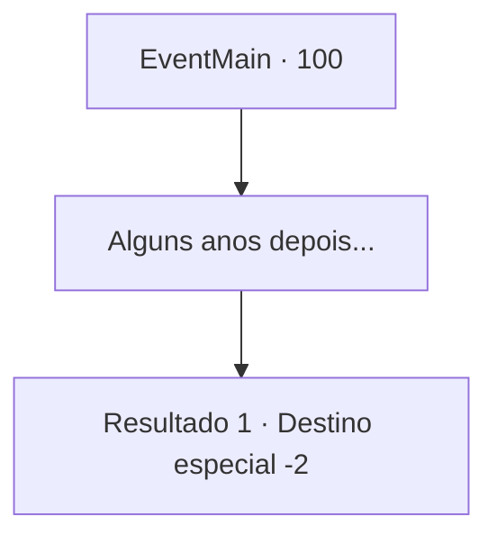

# Eventos principais · 100

[Índice da tabela](index.md) · [Índice geral](../index.md)

ID: `pt:EventMain:100` · Fonte: `EventMain4` · Versão: 1.2.47.

Mapeamento estático dos arquivos; a disponibilidade e a execução dependem do estado da run.

## Texto do evento

*Sem texto no arquivo.*

## Dados de entrada

```json
{
  "id": 100,
  "grade": 1,
  "normalGoal": "",
  "required": ""
}
```

## Mapa das escolhas



## Escolhas e resultados

### Escolha 1

Alguns anos depois...

Requisitos e outros campos da escolha:

```json
{
  "required": ""
}
```

#### Resultado 1.1

Você treina por anos com a Bruxa Índigo.
 Depois de aprender tudo o que ela tem para te ensinar, ela pega uma varinha e te dá de presente. 

 "Aqui, isso costumava ser meu. Eu não preciso disso, mas você, pequena, poderia usar uma boa varinha."

 Você pega a varinha e continua sua jornada.

Continuação registrada: [Destino especial `-2`](../destinos-especiais.md).

```json
{
  "required": "",
  "chance": "1",
  "nextEvent": -2,
  "type": 2,
  "reward": "13_1_9|3_91_1|0_7_3|0_14_2|0_2_3"
}
```

## Referências que chegam a este evento

- [Evento 98 · escolha 2 · resultado 1](0098.md#escolha-2)
- [Evento 99 · escolha 3 · resultado 1](0099.md#escolha-3)
