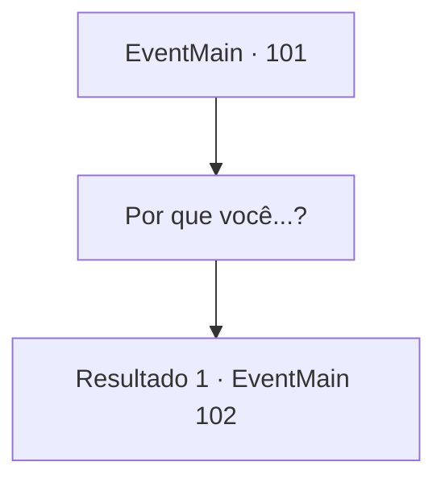

# Eventos principais · 101

[Índice da tabela](index.md) · [Índice geral](../index.md)

ID: `pt:EventMain:101` · Fonte: `EventMain4` · Versão: 1.2.47.

Mapeamento estático dos arquivos; a disponibilidade e a execução dependem do estado da run.

## Texto do evento

Você entra em uma grande cidade. Mas você não vê ninguém. Você olha por toda parte, mas nenhuma alma pode ser vista. Então alguém fala com você de baixo. 

 "Ei, você não é {1}?"|drawing_talkMouse| Você olha para baixo e se depara com um pequeno rato. Ele olha para você e move sua pequena boca. 

 "É você...! Eu sou o Professor Flu da Torre da Magia. Eu ensinei você a analisar e usar a magia antiga."


## Dados de entrada

```json
{
  "id": 101,
  "grade": 1,
  "normalGoal": "",
  "required": "13_1_9|1_2_80"
}
```

## Mapa das escolhas



## Escolhas e resultados

### Escolha 1

Por que você...?

Requisitos e outros campos da escolha:

```json
{
  "required": ""
}
```

#### Resultado 1.1

Você se lembra das aulas do Professor Flu de seu tempo na Torre da Magia. Ele era um velho cavalheiro que gostava de se vestir com um terno marrom elegante. Você pergunta o que aconteceu com ele, e o professor roedor responde com uma voz triste. Ele explica que Halad assumiu a Torre da Magia, e que ela sobrevoa a cidade usando a força da torre para caçar pessoas e encantá-las. 

 "Eu tentei impedi-la e acabei assim. Meu gato quase me comeu."


Continuação registrada: [Evento 102](0102.md) na mesma tabela.

```json
{
  "required": "",
  "chance": "1",
  "nextEvent": 102,
  "type": 2,
  "reward": ""
}
```

## Referências que chegam a este evento

Nenhum `nextEvent` positivo da mesma tabela aponta para este nó. Isso não prova que seja inacessível: sorteio e estado de história podem selecioná-lo.

