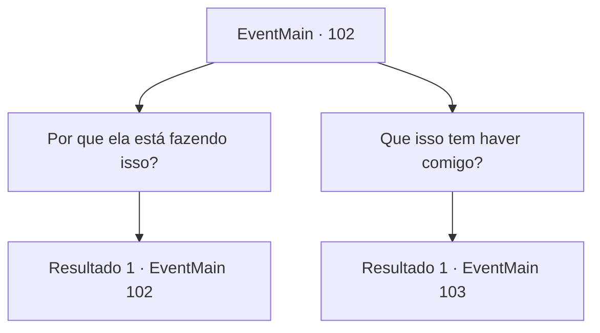

# Eventos principais · 102

[Índice da tabela](index.md) · [Índice geral](../index.md)

ID: `pt:EventMain:102` · Fonte: `EventMain4` · Versão: 1.2.47.

Mapeamento estático dos arquivos; a disponibilidade e a execução dependem do estado da run.

## Texto do evento

*Sem texto no arquivo.*

## Dados de entrada

```json
{
  "id": 102,
  "grade": 1,
  "normalGoal": "",
  "required": ""
}
```

## Mapa das escolhas



## Escolhas e resultados

### Escolha 1

Por que ela está fazendo isso?

Requisitos e outros campos da escolha:

```json
{
  "required": "5_66_0"
}
```

#### Resultado 1.1

Você pergunta por que Halad está fazendo tudo isso. O professor roedor escova os bigodes enquanto fala. 

 "Eu acredito... que ela quer se tornar um deus. A magia antiga fala de um ritual agora proibido que transforma Magos em deuses. Ela está encantando as pessoas como parte deste ritual."


Continuação registrada: [Evento 102](0102.md) na mesma tabela.

```json
{
  "required": "",
  "chance": "1",
  "nextEvent": 102,
  "type": 2,
  "reward": "5_66_1"
}
```

### Escolha 2

Que isso tem haver comigo?

Requisitos e outros campos da escolha:

```json
{
  "required": ""
}
```

#### Resultado 2.1

O professor roedor sobe em sua perna e em seu ombro. Ele recupera o fôlego antes de responder. 

 "Eu quero que você tire essa maldição de mim. Eu sei que você guarda rancor contra Halad. Acabe com essa maldição e eu te ajudarei com tudo o que tenho."


Continuação registrada: [Evento 103](0103.md) na mesma tabela.

```json
{
  "required": "",
  "chance": "1",
  "nextEvent": 103,
  "type": 2,
  "reward": ""
}
```

## Referências que chegam a este evento

- [Evento 101 · escolha 1 · resultado 1](0101.md#escolha-1)
- [Evento 102 · escolha 1 · resultado 1](0102.md#escolha-1)
