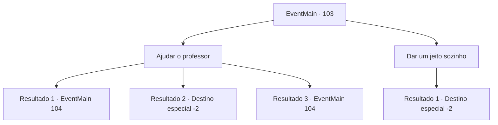

# Eventos principais · 103

[Índice da tabela](index.md) · [Índice geral](../index.md)

ID: `pt:EventMain:103` · Fonte: `EventMain4` · Versão: 1.2.47.

Mapeamento estático dos arquivos; a disponibilidade e a execução dependem do estado da run.

## Texto do evento

*Sem texto no arquivo.*

## Dados de entrada

```json
{
  "id": 103,
  "grade": 1,
  "normalGoal": "",
  "required": ""
}
```

## Mapa das escolhas



## Escolhas e resultados

### Escolha 1

Ajudar o professor

Requisitos e outros campos da escolha:

```json
{
  "required": ""
}
```

#### Resultado 1.1

Você decide ajudar o Flu. Ele continua nervoso. 

 "Conheço uma especialista em maldição engenhosa... Prefiro não estar em dívida com ela, mas não há outra escolha. Leve-me para Dorione Forest."

 Você leva o professor para um lugar familiar. Vocês dois estão na frente da cabana da Bruxa Índigo. Ela abre a porta, parecendo confusa. 

 "O que..? Por quê você está aqui? Espere um minuto..."

 Ela começa a rir no momento em que vê o professor em seu ombro. 

 "Hahahaha! O que aconteceu com você, Flu?"

 Seus bigodes tremem quando ele exige que ela retire sua maldição. Mas Terria o ignora e olha para você. 

 "Eu não sei o que está acontecendo aqui... mas eu vou te ajudar se você entregar o mouse."


Continuação registrada: [Evento 104](0104.md) na mesma tabela.

```json
{
  "required": "18_6_3",
  "chance": "1",
  "nextEvent": 104,
  "type": 2,
  "reward": "3_135_1"
}
```

#### Resultado 1.2

Você decide ajudar o Flu. Ele continua nervoso. 

 "Conheço uma especialista em maldição engenhosa... Prefiro não estar em dívida com ela, mas não há outra escolha. Leve-me para Dorione Forest."

 Vocês dois chegam a uma velha cabana na floresta. Mas está em frangalhos. O focinho do professor se contorce enquanto ele murmura para si mesmo. 

 "Não... não... Não era isso que eu tinha em mente..."

 Ele permanece em silêncio por um tempo antes de falar novamente. 

 "Para a Torre da Magia."

 Você enfia o professor no bolso. Juntos, vocês dois vão para a Torre da Magia que Halad assumiu.

Continuação registrada: [Destino especial `-2`](../destinos-especiais.md).

```json
{
  "required": "5_6_3",
  "chance": "1",
  "nextEvent": -2,
  "type": 2,
  "reward": "13_1_11|3_135_1"
}
```

#### Resultado 1.3

Você decide ajudar o Flu. Ele continua, com um olhar nervoso no rosto. 

 "Acontece que eu conheço o especialista quando se trata de maldições... por mais que isso me incomode, não há outra escolha. Vamos para a Floresta Dorione."

 Vocês dois chegam a uma velha cabana na floresta. A porta da cabana se abre e uma mulher de vestido azul se revela. 

 "Huh..? O que? Espere...."

 Ela olha para o rato em seu ombro e cai na gargalhada. 

 "Pffffthaahah! Oh, Flu, o que aconteceu com você!"

 Seus bigodes tremem, enquanto ele pede a ela para acabar com sua maldição. Mas ela fala com você. 

 "Hmph. Em primeiro lugar, eu sou Terria. Não tenho certeza do que está acontecendo aqui... mas eu te ajudo se você entregar o mouse."

 

Continuação registrada: [Evento 104](0104.md) na mesma tabela.

```json
{
  "required": "5_63_9",
  "chance": "1",
  "nextEvent": 104,
  "type": 2,
  "reward": "3_135_1"
}
```

### Escolha 2

Dar um jeito sozinho

Requisitos e outros campos da escolha:

```json
{
  "required": ""
}
```

#### Resultado 2.1

Você coloca o professor no seu bolso. Juntos, vocês dois vão para a Torre da Magia que Halad assumiu.

Continuação registrada: [Destino especial `-2`](../destinos-especiais.md).

```json
{
  "required": "",
  "chance": "1",
  "nextEvent": -2,
  "type": 2,
  "reward": "3_135_1|0_2_1|13_1_11"
}
```

## Referências que chegam a este evento

- [Evento 102 · escolha 2 · resultado 1](0102.md#escolha-2)
- [Evento 206 · escolha 2 · resultado 1](0206.md#escolha-2)
