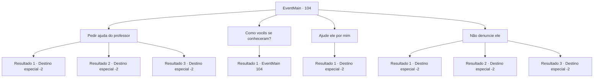

# Eventos principais · 104

[Índice da tabela](index.md) · [Índice geral](../index.md)

ID: `pt:EventMain:104` · Fonte: `EventMain4` · Versão: 1.2.47.

Mapeamento estático dos arquivos; a disponibilidade e a execução dependem do estado da run.

## Texto do evento

*Sem texto no arquivo.*

## Dados de entrada

```json
{
  "id": 104,
  "grade": 1,
  "normalGoal": "",
  "required": ""
}
```

## Mapa das escolhas



## Escolhas e resultados

### Escolha 1

Pedir ajuda do professor

Requisitos e outros campos da escolha:

```json
{
  "required": "8_135_1"
}
```

#### Resultado 1.1

Você entrega o professor roedor. Ela o tranca em uma gaiola. 

 "Você... eu não posso acreditar que você está fazendo isso comigo ..!"

 Terria ignora seu apelo e fala com você. 

 "Agora, onde estávamos? Certo, por que ele é um rato, e o que diabos está acontecendo?"

 Você explica a ela o que o professor lhe disse. Ela assente e continua. 

 "Entendo, entendo... Bem, você era um aluno adorável e me deu gripe, então sim, eu ajudo."

 Terria promete encontrá-lo na Torre da Magia.

Continuação registrada: [Destino especial `-2`](../destinos-especiais.md).

```json
{
  "required": "13_1_9",
  "chance": "1",
  "nextEvent": -2,
  "type": 2,
  "reward": "4_135_1|0_2_1|0_3_-1|13_1_12"
}
```

#### Resultado 1.2

Você entrega o professor roedor. Ela o tranca em uma gaiola. 

 "Você... eu não posso acreditar que você está fazendo isso comigo ..!"

 Terria ignora seu apelo e fala com você. 

 "Agora, onde estávamos? Certo, por que ele é um rato, e o que diabos está acontecendo?"

 Você explica a ela o que o professor lhe disse. Ela assente e continua 

 "Entendo... Bem, você me deu gripe, então acho que devo ajudar."

 Terria promete encontrá-lo na Torre da Magia.

Continuação registrada: [Destino especial `-2`](../destinos-especiais.md).

```json
{
  "required": "13_1_10",
  "chance": "1",
  "nextEvent": -2,
  "type": 2,
  "reward": "4_135_1|0_2_1|0_3_-1|13_1_12|5_99_1"
}
```

#### Resultado 1.3

Você entrega o professor rato. Ela o trancou em uma pequena gaiola. 

 "Você... eu não posso acreditar que você está fazendo isso comigo..!"

 Ignorando seu apelo, Terria continua. 

 "Agora, onde estávamos? Certo, por que ele é um rato, e o que diabos está acontecendo?"

 Você explica a ela, exatamente o que o professor lhe disse. 

 "Entendo .. Bem, eu tenho gripe, então vou te dar uma mão."

 Você promete encontrar Terria novamente na Torre da Magia.

Continuação registrada: [Destino especial `-2`](../destinos-especiais.md).

```json
{
  "required": "13_1_19",
  "chance": "1",
  "nextEvent": -2,
  "type": 2,
  "reward": "4_135_1|0_2_1|0_3_-1|13_1_12|5_99_1"
}
```

### Escolha 2

Como vocês se conheceram?

Requisitos e outros campos da escolha:

```json
{
  "required": "5_67_0"
}
```

#### Resultado 2.1

Você pergunta a Terria e Flu como eles se conhecem. O professor fica em silêncio enquanto a bruxa responde. 

 "Nós, hmm... costumávamos namorar um tempo atrás. Não terminou bem, graças ao seu ego teimoso."

 O professor assobia em desconforto.

Continuação registrada: [Evento 104](0104.md) na mesma tabela.

```json
{
  "required": "",
  "chance": "1",
  "nextEvent": 104,
  "type": 2,
  "reward": "5_67_1"
}
```

### Escolha 3

Ajude ele por mim

Requisitos e outros campos da escolha:

```json
{
  "required": "13_1_9"
}
```

#### Resultado 3.1

Você implora a ela para acabar com a maldição do professor. A Bruxa Índigo está feliz em fazê-lo. Ela desenha um círculo mágico no chão, coloca o professor roedor no meio e começa a entoar um feitiço. O processo demora bastante, e a bruxa começa a suar depois de algumas horas. Então você ouve algo quebrar e encontra o professor roedor em sua forma humana. |drawing_nakedProf| Você vê um velho nu com cabelos brancos parado na sua frente. Você está feliz em vê-lo de volta, mas decide deixá-lo sozinho até que ele esteja fora de seu traje de aniversário. Logo, um Flu totalmente vestido segue você para fora. Vocês dois prometem se encontrar na Torre da Magia.

Continuação registrada: [Destino especial `-2`](../destinos-especiais.md).

```json
{
  "required": "",
  "chance": "1",
  "nextEvent": -2,
  "type": 2,
  "reward": "13_1_13|0_2_1|0_3_1|4_135_1"
}
```

### Escolha 4

Não denuncie ele

Requisitos e outros campos da escolha:

```json
{
  "required": ""
}
```

#### Resultado 4.1

Você se recusa a entregar o professor. Terria parece um pouco desapontada. 

 "Heh... você perdeu uma grande piada. Tudo bem, eu vou acabar com a maldição dele."

 Ela desenha um círculo mágico no chão, coloca o professor roedor no meio e começa a entoar um feitiço. O processo demora bastante, e a bruxa começa a suar depois de algumas horas. Então você ouve algo quebrar e encontra o professor roedor em sua forma humana. |drawing_nakedProf| Você vê um velho nu com cabelos brancos parado na sua frente. Você está feliz em vê-lo de volta, mas decide deixá-lo sozinho até que ele esteja fora de seu traje de aniversário. Logo, um Flu totalmente vestido segue você para fora. Vocês dois prometem se encontrar na Torre da Magia.

Continuação registrada: [Destino especial `-2`](../destinos-especiais.md).

```json
{
  "required": "13_1_9",
  "chance": "1",
  "nextEvent": -2,
  "type": 2,
  "reward": "13_1_13|0_2_1|0_3_1|4_135_1"
}
```

#### Resultado 4.2

Você se recusa a entregar o professor. Terria parece um pouco desapontada. 

 "Heh... você perdeu uma grande piada. Tudo bem, então vá. Boa sorte levantando essa maldição!"

 Você não consegue acabar com a maldição do professor, e vocês dois vão para a Torre da Magia.

Continuação registrada: [Destino especial `-2`](../destinos-especiais.md).

```json
{
  "required": "13_1_10",
  "chance": "1",
  "nextEvent": -2,
  "type": 2,
  "reward": "13_1_11"
}
```

#### Resultado 4.3

Você se recusa a entregar o professor. Terria parece um pouco desapontada. 

 "Heh... você perdeu uma grande piada. Tudo bem, então vá. Boa sorte levantando essa maldição!"

 Você não consegue acabar com a maldição do professor, e vocês dois vão para a Torre da Magia.

Continuação registrada: [Destino especial `-2`](../destinos-especiais.md).

```json
{
  "required": "13_1_19",
  "chance": "1",
  "nextEvent": -2,
  "type": 2,
  "reward": "13_1_11"
}
```

## Referências que chegam a este evento

- [Evento 103 · escolha 1 · resultado 1](0103.md#escolha-1)
- [Evento 103 · escolha 1 · resultado 3](0103.md#escolha-1)
- [Evento 104 · escolha 2 · resultado 1](0104.md#escolha-2)
