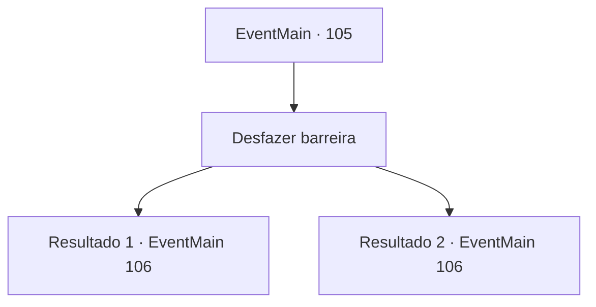

# Eventos principais · 105

[Índice da tabela](index.md) · [Índice geral](../index.md)

ID: `pt:EventMain:105` · Fonte: `EventMain4` · Versão: 1.2.47.

Mapeamento estático dos arquivos; a disponibilidade e a execução dependem do estado da run.

## Texto do evento

|drawing_floatingTower| Você encontra a Torre da Magia voando pelas planícies.  Você se aproxima dela usando sua magia de voo.  Como você esperava, a torre é guardada por uma barreira.

## Dados de entrada

```json
{
  "id": 105,
  "grade": 1,
  "normalGoal": "",
  "required": "13_1_11|1_2_100"
}
```

## Mapa das escolhas



## Escolhas e resultados

### Escolha 1

Desfazer barreira

Requisitos e outros campos da escolha:

```json
{
  "required": ""
}
```

#### Resultado 1.1

Você sabota a magia de Halad, um feitiço de cada vez. A barreira lentamente se torna mais fina até desaparecer. Você entra na torre, exausto. Estudiosos encantados estão esperando por você lá dentro. Eles não se parecem muito.

Continuação registrada: [Evento 106](0106.md) na mesma tabela.

```json
{
  "required": "10_135_1",
  "chance": "1",
  "nextEvent": 106,
  "type": 2,
  "reward": "0_2_1"
}
```

#### Resultado 1.2

Você sente a barreira com as mãos enquanto o professor sai da sua bolsa. 

 "Deixe esta parte para mim. Você terá que economizar sua energia para a grande luta."

 Ele fica na ponta da sua mão e começa a roer a barreira. Momentos depois, ele produz um buraco grande o suficiente para uma pessoa se espremer. Você rompe com sucesso para o outro lado da barreira. A torre está sendo guardada por estudiosos encantados. Eles não se parecem muito.

Continuação registrada: [Evento 106](0106.md) na mesma tabela.

```json
{
  "required": "8_135_1",
  "chance": "1",
  "nextEvent": 106,
  "type": 2,
  "reward": ""
}
```

## Referências que chegam a este evento

Nenhum `nextEvent` positivo da mesma tabela aponta para este nó. Isso não prova que seja inacessível: sorteio e estado de história podem selecioná-lo.

