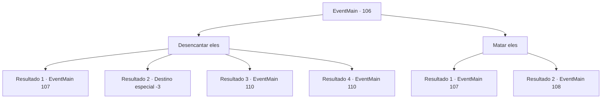

# Eventos principais · 106

[Índice da tabela](index.md) · [Índice geral](../index.md)

ID: `pt:EventMain:106` · Fonte: `EventMain4` · Versão: 1.2.47.

Mapeamento estático dos arquivos; a disponibilidade e a execução dependem do estado da run.

## Texto do evento

*Sem texto no arquivo.*

## Dados de entrada

```json
{
  "id": 106,
  "grade": 1,
  "normalGoal": "",
  "required": ""
}
```

## Mapa das escolhas



## Escolhas e resultados

### Escolha 1

Desencantar eles

Requisitos e outros campos da escolha:

```json
{
  "required": ""
}
```

#### Resultado 1.1

Você tenta desencantá-los. Mas seus feitiços são muito complicados para você desfazer. A vertigem o domina enquanto os feitiços emanam energia resistente. Além disso, os estudiosos o localizam e o atacam com fúria cega.

Continuação registrada: [Evento 107](0107.md) na mesma tabela.

```json
{
  "required": "1_1_2",
  "chance": "14",
  "nextEvent": 107,
  "type": 1,
  "reward": "6_3_71|0_1_-1",
  "place": 7
}
```

#### Resultado 1.2

Você tenta desencantá-los. Mas seus feitiços são muito complicados para você desfazer. A vertigem o domina enquanto os feitiços emanam energia resistente. O mundo fica escuro.

Continuação registrada: [Destino especial `-3`](../destinos-especiais.md).

```json
{
  "required": "2_1_2",
  "chance": "14",
  "nextEvent": -3,
  "type": 1,
  "reward": "0_1_-1"
}
```

#### Resultado 1.3

Você desencanta com sucesso os estudiosos. Eles recuperam a consciência e choram lágrimas de gratidão. <link=shake>

 "I-I...eu estava apavorado. Eu senti que... eu não estava mais no controle de mim mesmo, foi horrível... Muito obrigado!"

</link> Os estudiosos concordam em ajudá-lo a chegar à torre. Você entra com eles. As regras do mundo exterior não se aplicam ao interior, então a magia do voo não é uma opção. Você entra no saguão do primeiro andar e uma estátua de uma gárgula está esperando por você. 

 "Se identifique."

 Os estudiosos respondem 'Servos de Halad', e a gárgula se afasta para revelar uma porta. Ele se abre para uma espiral de escadas que conduzem.

Continuação registrada: [Evento 110](0110.md) na mesma tabela.

```json
{
  "required": "10_135_1",
  "chance": "1|0_7_1",
  "nextEvent": 110,
  "type": 0,
  "reward": "13_1_14"
}
```

#### Resultado 1.4

Com a ajuda do Professor Rato, Você desencanta com sucesso os estudiosos. Eles recuperam a consciência e choram lágrimas de gratidão. <link=shake>

 "I-I...eu estava apavorado. Eu senti que... eu não estava mais no controle de mim mesmo, foi horrível... Muito obrigado!"

</link> Eles trocam cumprimentos com o Professor Flu, que havia se transformado em um rato. Os estudiosos concordam em ajudá-lo a chegar à torre. Você entra com eles. As regras do mundo exterior não se aplicam ao interior, então a magia do voo não é uma opção. Você entra no saguão do primeiro andar e uma estátua de uma gárgula está esperando por você. 

 "Se identifique."

 Os estudiosos respondem 'Servos de Halad', e a gárgula se afasta para revelar uma porta. Ele se abre para uma espiral de escadas que conduzem. Então, o Professor Rato fala com um tom de arrependimento:  

 "Seria bom se você pudesse usar a passagem em meu laboratório, mas é muito pequena para todos nós irmos juntos. Vamos nos apressar para as escadas, em vez disso."


Continuação registrada: [Evento 110](0110.md) na mesma tabela.

```json
{
  "required": "8_135_1",
  "chance": "1|0_7_2",
  "nextEvent": 110,
  "type": 0,
  "reward": "13_1_14|15_2_19"
}
```

### Escolha 2

Matar eles

Requisitos e outros campos da escolha:

```json
{
  "required": ""
}
```

#### Resultado 2.1

Você saca sua arma, decidindo lutar contra seus ex-colegas de classe. Eles cobram de você, babando.

Continuação registrada: [Evento 107](0107.md) na mesma tabela.

```json
{
  "required": "10_135_1",
  "chance": "1",
  "nextEvent": 107,
  "type": 2,
  "reward": "6_0_71",
  "place": 7
}
```

#### Resultado 2.2

Você saca sua arma quando o professor interrompe. 

 "Por favor, não... Lembre-se, eles são meus discípulos. São todos meus alunos... vou distraí-los. Você sobe na torre. Você encontrará Halad no topo."

 O professor pula do seu ombro. Então ele morde um dos estudiosos encantados no calcanhar. 

 "Argh! Seu rato imundo ..!"

 Você é capaz de esgueirar-se para dentro graças à ajuda do professor. As regras do mundo exterior não se aplicam na torre, então a magia de voo não é uma opção. Você entra no saguão do primeiro andar e uma estátua de uma gárgula está esperando por você. 

 "Se identifique."


Continuação registrada: [Evento 108](0108.md) na mesma tabela.

```json
{
  "required": "8_135_1",
  "chance": "1",
  "nextEvent": 108,
  "type": 2,
  "reward": "0_2_1|15_2_19"
}
```

## Referências que chegam a este evento

- [Evento 105 · escolha 1 · resultado 1](0105.md#escolha-1)
- [Evento 105 · escolha 1 · resultado 2](0105.md#escolha-1)
