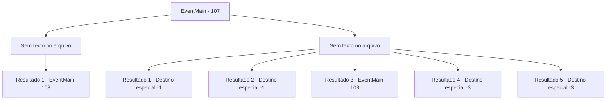

# Eventos principais · 107

[Índice da tabela](index.md) · [Índice geral](../index.md)

ID: `pt:EventMain:107` · Fonte: `EventMain4` · Versão: 1.2.47.

Mapeamento estático dos arquivos; a disponibilidade e a execução dependem do estado da run.

## Texto do evento

*Sem texto no arquivo.*

## Dados de entrada

```json
{
  "id": 107,
  "grade": 1,
  "normalGoal": "",
  "required": ""
}
```

## Mapa das escolhas



## Escolhas e resultados

### Escolha 1

*Sem texto no arquivo; o papel dessa opção depende da interface do jogo.*

Requisitos e outros campos da escolha:

```json
{
  "required": ""
}
```

#### Resultado 1.1

Você bate nos acadêmicos apenas o suficiente para eles desmaiarem. Então você entra na torre. As regras do mundo exterior não se aplicam ao interior, então a magia do voo não é uma opção. Você entra no saguão do primeiro andar e uma estátua de uma gárgula está esperando por você. 

 "Se identifique."


Continuação registrada: [Evento 108](0108.md) na mesma tabela.

```json
{
  "required": "",
  "chance": "1",
  "nextEvent": 108,
  "type": 2,
  "reward": ""
}
```

### Escolha 2

*Sem texto no arquivo; o papel dessa opção depende da interface do jogo.*

Requisitos e outros campos da escolha:

```json
{
  "required": ""
}
```

#### Resultado 2.1

Você é capturado pelos estudiosos. Eles o trancam no porão da torre. Então eles o cercam e começam a entoar feitiços. Você sente uma dor horrível como se alguém estivesse esmagando seu cérebro, até que você não aguenta mais e o mundo fica escuro.

Continuação registrada: [Destino especial `-1`](../destinos-especiais.md).

```json
{
  "required": "1_0_2|1_1_2|10_135_1|23_1_1",
  "chance": "1",
  "nextEvent": -1,
  "type": 2,
  "reward": "15_2_0|0_0_-1|0_1_-1|29_0_7|29_5_5|29_5_8|29_5_7|29_7_9|29_9_2|29_9_4|29_9_6|15_2_21"
}
```

#### Resultado 2.2

Você é capturado pelos estudiosos. Eles o trancam no porão da torre. Então eles o cercam e começam a entoar feitiços. Você sente uma dor horrível como se alguém estivesse esmagando seu cérebro, até que você não aguenta mais e o mundo fica escuro.

Continuação registrada: [Destino especial `-1`](../destinos-especiais.md).

```json
{
  "required": "1_0_2|1_1_2|10_135_1|24_1_1",
  "chance": "1",
  "nextEvent": -1,
  "type": 2,
  "reward": "15_2_0|0_0_-1|0_1_-1"
}
```

#### Resultado 2.3

Assim como você está prestes a entrar em sério perigo, o professor corre e morde os pés dos estudiosos. 

 "Argh! Seu rato imundo...!"

 Você é capaz de esgueirar-se para dentro graças à ajuda do professor. As regras do mundo exterior não se aplicam na torre, então a magia de voo não é uma opção. Você entra no lobby do primeiro andar e uma estátua de uma estátua de uma gárgula está esperando por você. 

 "Se identifique."


Continuação registrada: [Evento 108](0108.md) na mesma tabela.

```json
{
  "required": "1_0_2|1_1_2|8_135_1",
  "chance": "1",
  "nextEvent": 108,
  "type": 2,
  "reward": "0_2_1|0_0_-1|0_1_-1|15_2_19"
}
```

#### Resultado 2.4

Os estudiosos encantados matam você. Eles não parecem se importar ou perceber que você já foi colega de classe deles.

Continuação registrada: [Destino especial `-3`](../destinos-especiais.md).

```json
{
  "required": "2_0_2",
  "chance": "1",
  "nextEvent": -3,
  "type": 2,
  "reward": "0_0_-1|0_1_-1"
}
```

#### Resultado 2.5

Os estudiosos encantados matam você. Eles não parecem se importar ou perceber que você já foi colega de classe deles.

Continuação registrada: [Destino especial `-3`](../destinos-especiais.md).

```json
{
  "required": "2_1_2",
  "chance": "1",
  "nextEvent": -3,
  "type": 2,
  "reward": "0_0_-1|0_1_-1"
}
```

## Referências que chegam a este evento

- [Evento 106 · escolha 1 · resultado 1](0106.md#escolha-1)
- [Evento 106 · escolha 2 · resultado 1](0106.md#escolha-2)
