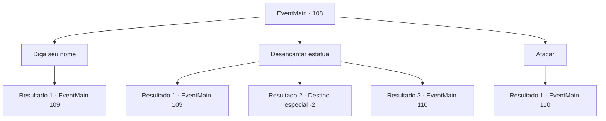

# Eventos principais · 108

[Índice da tabela](index.md) · [Índice geral](../index.md)

ID: `pt:EventMain:108` · Fonte: `EventMain4` · Versão: 1.2.47.

Mapeamento estático dos arquivos; a disponibilidade e a execução dependem do estado da run.

## Texto do evento

*Sem texto no arquivo.*

## Dados de entrada

```json
{
  "id": 108,
  "grade": 1,
  "normalGoal": "",
  "required": ""
}
```

## Mapa das escolhas



## Escolhas e resultados

### Escolha 1

Diga seu nome

Requisitos e outros campos da escolha:

```json
{
  "required": ""
}
```

#### Resultado 1.1

Você orgulhosamente se identifica como {1}. Mas a gárgula responde mecanicamente. 

 "Pessoal não autorizado."

 Ele revela suas garras afiadas e vem atacando você.

Continuação registrada: [Evento 109](0109.md) na mesma tabela.

```json
{
  "required": "",
  "chance": "1",
  "nextEvent": 109,
  "type": 2,
  "reward": "6_0_37",
  "place": 7
}
```

### Escolha 2

Desencantar estátua

Requisitos e outros campos da escolha:

```json
{
  "required": ""
}
```

#### Resultado 2.1

Você falha em desencantar a gárgula. Uma vertigem toma conta de você quando os feitiços emanam energia resistente. A gárgula responde mecanicamente. 

 "Atividade perigosa detectada."

 Ele revela suas garras afiadas e vem atacando você.

Continuação registrada: [Evento 109](0109.md) na mesma tabela.

```json
{
  "required": "1_1_2",
  "chance": "14",
  "nextEvent": 109,
  "type": 1,
  "reward": "6_3_37",
  "place": 7
}
```

#### Resultado 2.2

Você falha em desencantar a gárgula. Uma vertigem toma conta de você quando os feitiços emanam energia resistente. O mundo fica escuro.

Continuação registrada: [Destino especial `-2`](../destinos-especiais.md).

```json
{
  "required": "2_1_2",
  "chance": "14",
  "nextEvent": -2,
  "type": 1,
  "reward": "0_1_-1"
}
```

#### Resultado 2.3

Você desencanta a gárgula e corta sua fonte de mana. Ele para e desmorona diante de você. A porta atrás dela se abre para uma espiral de escadas que levam para cima.

Continuação registrada: [Evento 110](0110.md) na mesma tabela.

```json
{
  "required": "",
  "chance": "1|0_7_1",
  "nextEvent": 110,
  "type": 0,
  "reward": ""
}
```

### Escolha 3

Atacar

Requisitos e outros campos da escolha:

```json
{
  "required": ""
}
```

#### Resultado 3.1

Você balança sua arma na gárgula. Ele responde mecanicamente. 

 "Atividade perigosa detectada."

 Ele revela suas garras afiadas e vem atacando você.

Continuação registrada: [Evento 110](0110.md) na mesma tabela.

```json
{
  "required": "",
  "chance": "1",
  "nextEvent": 110,
  "type": 2,
  "reward": "6_3_37",
  "place": 7
}
```

## Referências que chegam a este evento

- [Evento 106 · escolha 2 · resultado 2](0106.md#escolha-2)
- [Evento 107 · escolha 1 · resultado 1](0107.md#escolha-1)
- [Evento 107 · escolha 2 · resultado 3](0107.md#escolha-2)
