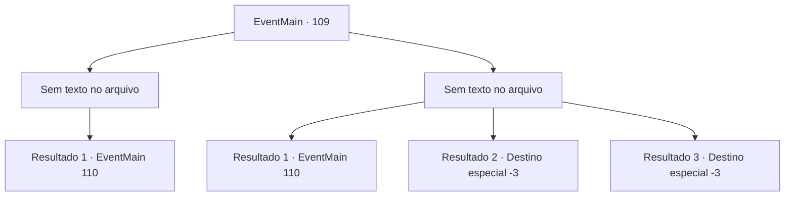

# Eventos principais · 109

[Índice da tabela](index.md) · [Índice geral](../index.md)

ID: `pt:EventMain:109` · Fonte: `EventMain4` · Versão: 1.2.47.

Mapeamento estático dos arquivos; a disponibilidade e a execução dependem do estado da run.

## Texto do evento

*Sem texto no arquivo.*

## Dados de entrada

```json
{
  "id": 109,
  "grade": 1,
  "normalGoal": "",
  "required": ""
}
```

## Mapa das escolhas



## Escolhas e resultados

### Escolha 1

*Sem texto no arquivo; o papel dessa opção depende da interface do jogo.*

Requisitos e outros campos da escolha:

```json
{
  "required": ""
}
```

#### Resultado 1.1

A gárgula se desfaz em pedaços. A porta atrás dela se abre para uma espiral de escadas que levam para cima.

Continuação registrada: [Evento 110](0110.md) na mesma tabela.

```json
{
  "required": "",
  "chance": "1",
  "nextEvent": 110,
  "type": 2,
  "reward": ""
}
```

### Escolha 2

*Sem texto no arquivo; o papel dessa opção depende da interface do jogo.*

Requisitos e outros campos da escolha:

```json
{
  "required": ""
}
```

#### Resultado 2.1

Você está perdendo. Mas então, você vê uma porta atrás da gárgula. Você corre em direção a ele, esquivando-se de um ataque bem a tempo. Lá dentro, você encontra uma escada em espiral que leva para cima.

Continuação registrada: [Evento 110](0110.md) na mesma tabela.

```json
{
  "required": "1_0_2|1_1_2",
  "chance": "1",
  "nextEvent": 110,
  "type": 2,
  "reward": "0_0_-1|0_1_-1|0_2_1"
}
```

#### Resultado 2.2

As garras da gárgula cavam em seu estômago. Seu sangue pinta o chão de vermelho e o mundo desaparece.

Continuação registrada: [Destino especial `-3`](../destinos-especiais.md).

```json
{
  "required": "2_0_2",
  "chance": "1",
  "nextEvent": -3,
  "type": 2,
  "reward": "0_0_-1|0_1_-1"
}
```

#### Resultado 2.3

As garras da gárgula cavam em seu estômago. Seu sangue pinta o chão de vermelho e o mundo desaparece.

Continuação registrada: [Destino especial `-3`](../destinos-especiais.md).

```json
{
  "required": "2_1_2",
  "chance": "1",
  "nextEvent": -3,
  "type": 2,
  "reward": "0_0_-1|0_1_-1"
}
```

## Referências que chegam a este evento

- [Evento 108 · escolha 1 · resultado 1](0108.md#escolha-1)
- [Evento 108 · escolha 2 · resultado 1](0108.md#escolha-2)
