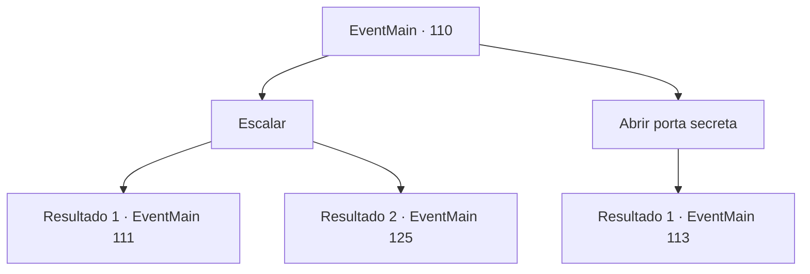

# Eventos principais · 110

[Índice da tabela](index.md) · [Índice geral](../index.md)

ID: `pt:EventMain:110` · Fonte: `EventMain4` · Versão: 1.2.47.

Mapeamento estático dos arquivos; a disponibilidade e a execução dependem do estado da run.

## Texto do evento

*Sem texto no arquivo.*

## Dados de entrada

```json
{
  "id": 110,
  "grade": 1,
  "normalGoal": "",
  "required": ""
}
```

## Mapa das escolhas



## Escolhas e resultados

### Escolha 1

Escalar

Requisitos e outros campos da escolha:

```json
{
  "required": ""
}
```

#### Resultado 1.1

Quanto mais alto você sobe, mais frio fica. Você logo está se arrastando por uma nevasca. Você pode continuar ou criar uma barreira protetora. O frio desgastará seu corpo, mas a barreira fará o mesmo com sua mente.

Continuação registrada: [Evento 111](0111.md) na mesma tabela.

```json
{
  "required": "13_1_11",
  "chance": "1",
  "nextEvent": 111,
  "type": 2,
  "reward": ""
}
```

#### Resultado 1.2

Você sobe a torre com os estudiosos. Quanto mais alto você sobe, mais frio fica. Você logo está se arrastando por uma nevasca. Um dos estudiosos cobertos de neve grita. 

 "Parece que Halad vai congelar todo o lugar!"

 Juntos, vocês formam barreiras de proteção para atravessar a nevasca. Não demora muito para você ficar cara a cara com um golem feito de gelo. Olhos em chamas, ele balança os punhos. 

 "Nós temos este, vá!"

 Os estudiosos começam a lutar contra o Golem, e você continua a subir a torre. 

 Você logo chega ao escritório do presidente. Tem uma moldura gigante para uma porta, cuja pintura confirma o visitante. Mas alguém rasgou a pintura em pedaços. Você entra no escritório e Halad se levanta de uma confortável cadeira de couro. 

 "Eu... não entendo. Por que você está constantemente no meu caminho?"


Continuação registrada: [Evento 125](0125.md) na mesma tabela.

```json
{
  "required": "13_1_14",
  "chance": "1",
  "nextEvent": 125,
  "type": 2,
  "reward": ""
}
```

### Escolha 2

Abrir porta secreta

Requisitos e outros campos da escolha:

```json
{
  "required": "1_14_10|5_68_0"
}
```

#### Resultado 2.1

Você percebe algo estranho no fluxo de ar. Após uma inspeção mais detalhada, você encontra uma porta secreta. Atrás dele está um cadáver mumificado vestido com roupas extravagantes e segurando um diário empoeirado. |drawing_deadAndDiary|

Continuação registrada: [Evento 113](0113.md) na mesma tabela.

```json
{
  "required": "",
  "chance": "1",
  "nextEvent": 113,
  "type": 2,
  "reward": "0_2_1|5_68_1"
}
```

## Referências que chegam a este evento

- [Evento 106 · escolha 1 · resultado 3](0106.md#escolha-1)
- [Evento 106 · escolha 1 · resultado 4](0106.md#escolha-1)
- [Evento 108 · escolha 2 · resultado 3](0108.md#escolha-2)
- [Evento 108 · escolha 3 · resultado 1](0108.md#escolha-3)
- [Evento 109 · escolha 1 · resultado 1](0109.md#escolha-1)
- [Evento 109 · escolha 2 · resultado 1](0109.md#escolha-2)
- [Evento 113 · escolha 3 · resultado 1](0113.md#escolha-3)
- [Evento 113 · escolha 4 · resultado 1](0113.md#escolha-4)
