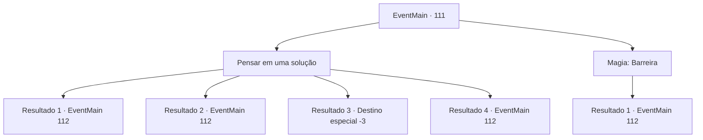

# Eventos principais · 111

[Índice da tabela](index.md) · [Índice geral](../index.md)

ID: `pt:EventMain:111` · Fonte: `EventMain4` · Versão: 1.2.47.

Mapeamento estático dos arquivos; a disponibilidade e a execução dependem do estado da run.

## Texto do evento

*Sem texto no arquivo.*

## Dados de entrada

```json
{
  "id": 111,
  "grade": 1,
  "normalGoal": "",
  "required": ""
}
```

## Mapa das escolhas



## Escolhas e resultados

### Escolha 1

Pensar em uma solução

Requisitos e outros campos da escolha:

```json
{
  "required": ""
}
```

#### Resultado 1.1

Você decide resistir e deixar sua mente intacta. Parece que sua pele pode cair enquanto você treme no frio. Não demora muito para você ficar cara a cara com um Golem feito de gelo. Olhos em chamas, ele balança os punhos.

Continuação registrada: [Evento 112](0112.md) na mesma tabela.

```json
{
  "required": "1_0_2|1_1_2",
  "chance": "12",
  "nextEvent": 112,
  "type": 1,
  "reward": "6_0_70|0_0_-1|0_2_1",
  "place": 7
}
```

#### Resultado 1.2

Você decide resistir e deixar sua mente intacta. Parece que sua pele pode cair enquanto você treme no frio. Eventualmente, você é forçado a se cobrir com uma barreira, o que cansa sua mente. Não demora muito para você ficar cara a cara com um Golem feito de gelo. Olhos em chamas, ele balança os punhos.

Continuação registrada: [Evento 112](0112.md) na mesma tabela.

```json
{
  "required": "2_0_2|1_1_2",
  "chance": "12",
  "nextEvent": 112,
  "type": 1,
  "reward": "6_0_70|0_1_-1|0_2_1",
  "place": 7
}
```

#### Resultado 1.3

Você desmaia no meio da nevasca.

Continuação registrada: [Destino especial `-3`](../destinos-especiais.md).

```json
{
  "required": "2_0_2|2_1_2",
  "chance": "12",
  "nextEvent": -3,
  "type": 2,
  "reward": "0_0_-1"
}
```

#### Resultado 1.4

Você decide resistir e deixar sua mente intacta. O frio nunca incomodou você de qualquer maneira. Não demora muito para você ficar cara a cara com um Golem feito de gelo. Olhos em chamas, ele balança os punhos.

Continuação registrada: [Evento 112](0112.md) na mesma tabela.

```json
{
  "required": "",
  "chance": "1|0_13_1",
  "nextEvent": 112,
  "type": 0,
  "reward": "6_0_70|0_2_1",
  "place": 7
}
```

### Escolha 2

Magia: Barreira

Requisitos e outros campos da escolha:

```json
{
  "required": "1_1_2|20_0_2"
}
```

#### Resultado 2.1

Você decide resistir e deixar sua mente intacta. O frio não te incomoda de qualquer maneira. Não demora muito para você ficar cara a cara com um Golem feito de gelo. Olhos em chamas, ele balança os punhos.

Continuação registrada: [Evento 112](0112.md) na mesma tabela.

```json
{
  "required": "",
  "chance": "1",
  "nextEvent": 112,
  "type": 2,
  "reward": "6_0_70|0_1_-1|0_2_1",
  "place": 7
}
```

## Referências que chegam a este evento

- [Evento 110 · escolha 1 · resultado 1](0110.md#escolha-1)
