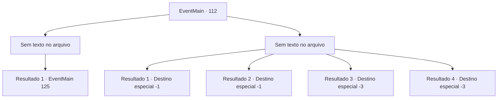

# Eventos principais · 112

[Índice da tabela](index.md) · [Índice geral](../index.md)

ID: `pt:EventMain:112` · Fonte: `EventMain4` · Versão: 1.2.47.

Mapeamento estático dos arquivos; a disponibilidade e a execução dependem do estado da run.

## Texto do evento

*Sem texto no arquivo.*

## Dados de entrada

```json
{
  "id": 112,
  "grade": 1,
  "normalGoal": "",
  "required": ""
}
```

## Mapa das escolhas



## Escolhas e resultados

### Escolha 1

*Sem texto no arquivo; o papel dessa opção depende da interface do jogo.*

Requisitos e outros campos da escolha:

```json
{
  "required": ""
}
```

#### Resultado 1.1

O Golem de Gelo desmorona e a nevasca morre com ele. Você sobe as escadas atrás de seus restos até o escritório do presidente no topo da torre. 

 Você está na frente do escritório do presidente. Tem uma moldura gigante para uma porta, cuja pintura confirma o visitante. Mas alguém rasgou a pintura em pedaços. Você entra no escritório e Halad se levanta de uma confortável cadeira de couro. 

 "Eu... não entendo. Por que você está constantemente no meu caminho?"


Continuação registrada: [Evento 125](0125.md) na mesma tabela.

```json
{
  "required": "",
  "chance": "1",
  "nextEvent": 125,
  "type": 2,
  "reward": ""
}
```

### Escolha 2

*Sem texto no arquivo; o papel dessa opção depende da interface do jogo.*

Requisitos e outros campos da escolha:

```json
{
  "required": ""
}
```

#### Resultado 2.1

O Golem de Gelo nocauteia você. Você acorda depois de algum tempo e percebe que está trancado no porão da torre. Alguém começa a entoar feitiços perto de você, e você sente uma dor horrível como se alguém estivesse esmagando seu cérebro. Você desmaia de novo.

Continuação registrada: [Destino especial `-1`](../destinos-especiais.md).

```json
{
  "required": "1_0_2|1_1_2|23_1_1",
  "chance": "1",
  "nextEvent": -1,
  "type": 2,
  "reward": "15_2_0|0_0_-1|0_1_-1|25_8_1|15_2_21"
}
```

#### Resultado 2.2

O Golem de Gelo nocauteia você. Você acorda depois de algum tempo e percebe que está trancado no porão da torre. Alguém começa a entoar feitiços perto de você, e você sente uma dor horrível como se alguém estivesse esmagando seu cérebro. Você desmaia de novo.

Continuação registrada: [Destino especial `-1`](../destinos-especiais.md).

```json
{
  "required": "1_0_2|1_1_2|24_1_1",
  "chance": "1",
  "nextEvent": -1,
  "type": 2,
  "reward": "15_2_0|0_0_-1|0_1_-1"
}
```

#### Resultado 2.3

O Golem de Gelo nocauteia você.

Continuação registrada: [Destino especial `-3`](../destinos-especiais.md).

```json
{
  "required": "2_0_2",
  "chance": "1",
  "nextEvent": -3,
  "type": 2,
  "reward": "0_0_-1|0_1_-1"
}
```

#### Resultado 2.4

O Golem de Gelo nocauteia você.

Continuação registrada: [Destino especial `-3`](../destinos-especiais.md).

```json
{
  "required": "2_1_2",
  "chance": "1",
  "nextEvent": -3,
  "type": 2,
  "reward": "0_0_-1|0_1_-1"
}
```

## Referências que chegam a este evento

- [Evento 111 · escolha 1 · resultado 1](0111.md#escolha-1)
- [Evento 111 · escolha 1 · resultado 2](0111.md#escolha-1)
- [Evento 111 · escolha 1 · resultado 4](0111.md#escolha-1)
- [Evento 111 · escolha 2 · resultado 1](0111.md#escolha-2)
