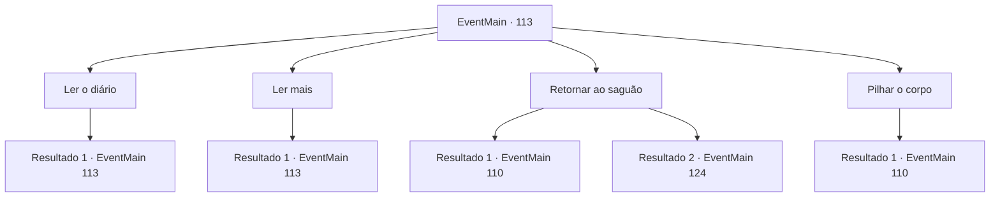

# Eventos principais · 113

[Índice da tabela](index.md) · [Índice geral](../index.md)

ID: `pt:EventMain:113` · Fonte: `EventMain4` · Versão: 1.2.47.

Mapeamento estático dos arquivos; a disponibilidade e a execução dependem do estado da run.

## Texto do evento

*Sem texto no arquivo.*

## Dados de entrada

```json
{
  "id": 113,
  "grade": 1,
  "normalGoal": "",
  "required": ""
}
```

## Mapa das escolhas



## Escolhas e resultados

### Escolha 1

Ler o diário

Requisitos e outros campos da escolha:

```json
{
  "required": "5_68_1"
}
```

#### Resultado 1.1

Você abre o diário e nuvens de poeira voam. Suas páginas de pele de carneiro são densamente preenchidas com letras limpas e precisas. 

 1º de março, 11
 Hoje viajo para a Torre da Magia .
 Como filha do Grande Mago Jenka,
 Devo provar minha excelência incomparável.
 Caso contrário, meu pai nunca me aprovará.
 *
 16 de novembro, 13
 O exame final foi um duelo, e minhas notas saíram hoje.
 Segundo de 163 discípulos. Perdi o primeiro lugar pela primeira vez desde que cheguei aqui.
 Meu pai ficou muito chateado e jogou uma garrafa de vinho vazia em mim.
 Por que não posso fazer melhor?
 *
 7 de abril, 14
 Encontrei um livro falante na biblioteca. Está cheio de conhecimento que eu nunca conheci.
 É um texto proibido, mas sua energia mística me fascina.
 Então alguém tentou tirar o livro de mim.
 Era um dos estudiosos, que só conheço de rosto.
 Tivemos uma briga na biblioteca e os professores vieram para ver o que estava acontecendo.
 Eu disse a eles que era ele quem estava tentando roubar o livro proibido.
 *
 30 de abril, 14
 Aquele delator perdedor foi expulso por tentar ler um texto proibido.
 Ele teve o que mereceu. Vou destruir qualquer um que ficar no meu caminho.
 O que for preciso.


Continuação registrada: [Evento 113](0113.md) na mesma tabela.

```json
{
  "required": "",
  "chance": "1",
  "nextEvent": 113,
  "type": 2,
  "reward": "5_68_2"
}
```

### Escolha 2

Ler mais

Requisitos e outros campos da escolha:

```json
{
  "required": "5_68_2"
}
```

#### Resultado 2.1

Você vasculha mais algumas páginas. 

 10 de julho, 15
 Está quente lá fora. Eu quebrei a perna de uma criança irritante.
 Ele chorou engraçado. Foi difícil tentar não rir.
 *
 5 de novembro, 15
 Houve outro teste. E decepcionei meu pai novamente.
 *
 7 de novembro, 15
 Pai morreu. De um ataque cardíaco.
 Nem o próprio Grande Mago conseguiu enganar a morte.
 E nunca consegui o reconhecimento dele.
 *
 31 de janeiro, 16
 O livro me ensinou como me tornar um deus.
 Sim, o 'deus' onisciente e onipotente.
 Eu vou me tornar um. Basta dez milhões de crentes e dez mil vidas.
 Vou trazer meu pai de volta dos mortos e fazê-lo ver que eu o superei.

 Esse é o fim do diário.

Continuação registrada: [Evento 113](0113.md) na mesma tabela.

```json
{
  "required": "",
  "chance": "1",
  "nextEvent": 113,
  "type": 2,
  "reward": "5_68_3"
}
```

### Escolha 3

Retornar ao saguão

Requisitos e outros campos da escolha:

```json
{
  "required": "5_68_3"
}
```

#### Resultado 3.1

Você sai da câmara escondida e retorna ao lobby.

Continuação registrada: [Evento 110](0110.md) na mesma tabela.

```json
{
  "required": "10_135_1",
  "chance": "1",
  "nextEvent": 110,
  "type": 2,
  "reward": ""
}
```

#### Resultado 3.2

Você sai da câmara escondida e volta para o saguão. O professor roedor, que lia o diário com você no ombro, começa a chiar. 

 "Halad... seu pobre sujeito. A pressão a deixou louca. Me siga. Há uma passagem secreta no meu laboratório."

 Ele leva você ao seu laboratório. O laboratório da gripe cheira a poeira velha, cheio até a borda com textos antigos e tábuas de pedra. Ele dá uma olhada nostálgica no lugar antes de correr para a lareira.

Continuação registrada: [Evento 124](0124.md) na mesma tabela.

```json
{
  "required": "8_135_1",
  "chance": "1",
  "nextEvent": 124,
  "type": 2,
  "reward": ""
}
```

### Escolha 4

Pilhar o corpo

Requisitos e outros campos da escolha:

```json
{
  "required": "2_3_0|10_106_1|5_76_0"
}
```

#### Resultado 4.1

Você revista os pertences do cadáver bem vestido. Não há muito mais para levar além de suas roupas. Não vai precisar dele de qualquer maneira. Uma escrita perto da área do peito do manto diz 'Grande Mago Jenka'. Você sai da câmara escondida e volta para o saguão.

Continuação registrada: [Evento 110](0110.md) na mesma tabela.

```json
{
  "required": "",
  "chance": "1",
  "nextEvent": 110,
  "type": 2,
  "reward": "3_106_1|0_3_-3|5_76_1"
}
```

## Referências que chegam a este evento

- [Evento 110 · escolha 2 · resultado 1](0110.md#escolha-2)
- [Evento 113 · escolha 1 · resultado 1](0113.md#escolha-1)
- [Evento 113 · escolha 2 · resultado 1](0113.md#escolha-2)
