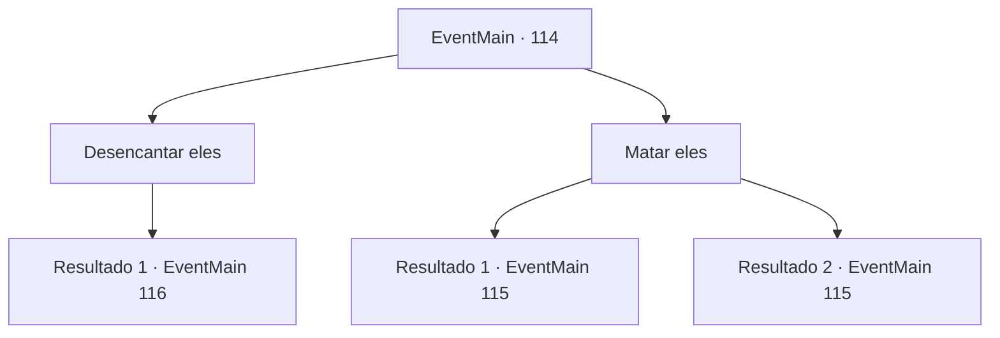

# Eventos principais · 114

[Índice da tabela](index.md) · [Índice geral](../index.md)

ID: `pt:EventMain:114` · Fonte: `EventMain4` · Versão: 1.2.47.

Mapeamento estático dos arquivos; a disponibilidade e a execução dependem do estado da run.

## Texto do evento

|drawing_floatingTower| Você encontra a Bruxa Índigo nas planícies perto da Torre da Magia voadora. 

 "Devemos?"

 Vocês dois sobem até a torre usando magia de vôo. Como esperado, a torre é cercada por uma barreira. Terria cria graciosamente uma abertura. Você e a bruxa entram na torre. Estudiosos enfeitiçados estão esperando por você lá dentro. Eles não parecem muito bem. Terria olha para você e pergunta. 

 "O que me diz, pequena?"


## Dados de entrada

```json
{
  "id": 114,
  "grade": 1,
  "normalGoal": "//마녀",
  "required": "13_1_12|1_2_100"
}
```

## Mapa das escolhas



## Escolhas e resultados

### Escolha 1

Desencantar eles

Requisitos e outros campos da escolha:

```json
{
  "required": ""
}
```

#### Resultado 1.1

Você sugere que você deve desencantá-los. Ela concorda e acena com a mão no ar. Os estudiosos encantados caem no chão como se ela cortasse suas cordas. 

 "Não se preocupe, eles estão inconscientes. Eu fui um pouco duro com eles."

 Terria lidera o caminho para a torre. As regras do mundo exterior não se aplicam na torre, então a magia de voo não é uma opção. Você entra no lobby do primeiro andar e uma estátua de uma estátua de uma gárgula está esperando por você. 

 "Se identifique."

 Terria ri e diz que é o material de aprendizagem perfeito. Ela pede que você desfaça a magia da estátua.

Continuação registrada: [Evento 116](0116.md) na mesma tabela.

```json
{
  "required": "",
  "chance": "1",
  "nextEvent": 116,
  "type": 2,
  "reward": "0_3_1"
}
```

### Escolha 2

Matar eles

Requisitos e outros campos da escolha:

```json
{
  "required": ""
}
```

#### Resultado 2.1

Eles perderam a capacidade de raciocinar. Você saca sua arma para enfrentar seus ex-colegas de classe. Terria olha para você com grandes expectativas. 

 "Agora, mostre-me o que você aprendeu."


Continuação registrada: [Evento 115](0115.md) na mesma tabela.

```json
{
  "required": "18_99_1",
  "chance": "1",
  "nextEvent": 115,
  "type": 2,
  "reward": "6_0_71",
  "place": 7
}
```

#### Resultado 2.2

Eles perderam a capacidade de raciocinar. Você saca sua arma para enfrentar seus ex-colegas de classe. Terria dá um passo para trás, de braços cruzados.

Continuação registrada: [Evento 115](0115.md) na mesma tabela.

```json
{
  "required": "5_99_1",
  "chance": "1",
  "nextEvent": 115,
  "type": 2,
  "reward": "6_0_71",
  "place": 7
}
```

## Referências que chegam a este evento

Nenhum `nextEvent` positivo da mesma tabela aponta para este nó. Isso não prova que seja inacessível: sorteio e estado de história podem selecioná-lo.

