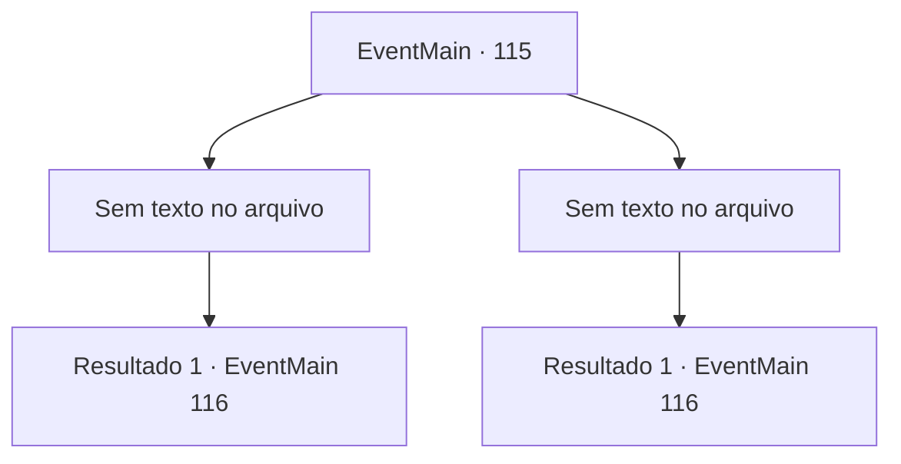

# Eventos principais · 115

[Índice da tabela](index.md) · [Índice geral](../index.md)

ID: `pt:EventMain:115` · Fonte: `EventMain4` · Versão: 1.2.47.

Mapeamento estático dos arquivos; a disponibilidade e a execução dependem do estado da run.

## Texto do evento

*Sem texto no arquivo.*

## Dados de entrada

```json
{
  "id": 115,
  "grade": 1,
  "normalGoal": "//승",
  "required": ""
}
```

## Mapa das escolhas



## Escolhas e resultados

### Escolha 1

*Sem texto no arquivo; o papel dessa opção depende da interface do jogo.*

Requisitos e outros campos da escolha:

```json
{
  "required": ""
}
```

#### Resultado 1.1

Você derrota os estudiosos facilmente e dá de ombros. Terria sorri e dirige-se para a torre. Terria lidera o caminho para a torre. As regras do mundo exterior não se aplicam na torre, então a magia de voo não é uma opção. Você entra no lobby do primeiro andar e uma estátua de uma estátua de uma gárgula está esperando por você. 

 "Se identifique."

 Terria ri e diz que é o material de aprendizagem perfeito. Ela pede que você desfaça a magia da estátua.

Continuação registrada: [Evento 116](0116.md) na mesma tabela.

```json
{
  "required": "",
  "chance": "1",
  "nextEvent": 116,
  "type": 2,
  "reward": ""
}
```

### Escolha 2

*Sem texto no arquivo; o papel dessa opção depende da interface do jogo.*

Requisitos e outros campos da escolha:

```json
{
  "required": ""
}
```

#### Resultado 2.1

Os estudiosos encantados se jogam em você. Eles são lutadores competentes e você fica sobrecarregado. Um míssil mágico atinge você de lado e o faz rolar no chão. Alguns deles atiram magia em Terria enquanto você cai. Ela acena com a mão no ar. Eles caem no chão como se ela cortasse suas cordas. 

 "Sempre pense em seu próximo passo, pequena."

 Terria cura você com sua magia e entra na torre. As regras do mundo exterior não se aplicam na torre, então a magia de voo não é uma opção. Você entra no lobby do primeiro andar e uma estátua de uma estátua de uma gárgula está esperando por você. 

 "Se identifique."

 Terria ri e diz que é o material de aprendizagem perfeito. Ela pede que você desfaça a magia da estátua.

Continuação registrada: [Evento 116](0116.md) na mesma tabela.

```json
{
  "required": "",
  "chance": "1",
  "nextEvent": 116,
  "type": 2,
  "reward": ""
}
```

## Referências que chegam a este evento

- [Evento 114 · escolha 2 · resultado 1](0114.md#escolha-2)
- [Evento 114 · escolha 2 · resultado 2](0114.md#escolha-2)
