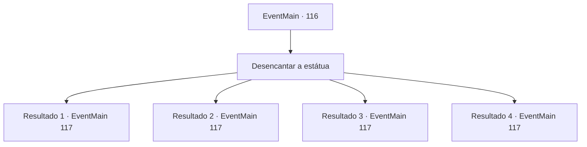

# Eventos principais · 116

[Índice da tabela](index.md) · [Índice geral](../index.md)

ID: `pt:EventMain:116` · Fonte: `EventMain4` · Versão: 1.2.47.

Mapeamento estático dos arquivos; a disponibilidade e a execução dependem do estado da run.

## Texto do evento

*Sem texto no arquivo.*

## Dados de entrada

```json
{
  "id": 116,
  "grade": 1,
  "normalGoal": "",
  "required": ""
}
```

## Mapa das escolhas



## Escolhas e resultados

### Escolha 1

Desencantar a estátua

Requisitos e outros campos da escolha:

```json
{
  "required": ""
}
```

#### Resultado 1.1

Você falha em desencantar a gárgula. Uma vertigem toma conta de você quando os feitiços emanam energia resistente. A gárgula responde mecanicamente. 

 "Atividade perigosa detectada."

 Terria a interrompe e desencanta ela mesma. 

 "Hmm... Vamos indo agora. Aulas extras podem esperar."

 Ela abre a porta atrás da gárgula e sobe as escadas.

Continuação registrada: [Evento 117](0117.md) na mesma tabela.

```json
{
  "required": "18_99_1",
  "chance": "13",
  "nextEvent": 117,
  "type": 1,
  "reward": ""
}
```

#### Resultado 1.2

Você falha em desencantar a gárgula. Uma vertigem toma conta de você quando os feitiços emanam energia resistente. A gárgula responde mecanicamente. 

 "Atividade perigosa detectada."

 Terria a interrompe e desencanta ela mesma. 

 "Pensei isso. Vamos indo."

 Ela abre a porta atrás da gárgula e sobe as escadas.

Continuação registrada: [Evento 117](0117.md) na mesma tabela.

```json
{
  "required": "5_99_1",
  "chance": "13",
  "nextEvent": 117,
  "type": 1,
  "reward": ""
}
```

#### Resultado 1.3

Você desencanta a gárgula e corta sua fonte de mana. Ele para e desmorona diante de você. A porta atrás dela se abre para uma espiral de escadas que levam para cima. Terria dá um tapinha em você no fundo. 

 "Bom trabalho, pequeno!"

 Então ela começa a subir as escadas.

Continuação registrada: [Evento 117](0117.md) na mesma tabela.

```json
{
  "required": "18_99_1",
  "chance": "1|0_7_1",
  "nextEvent": 117,
  "type": 0,
  "reward": "0_2_1"
}
```

#### Resultado 1.4

Você desencanta a gárgula e corta sua fonte de mana. Ele para e desmorona diante de você. A porta atrás dela se abre para uma espiral de escadas que levam para cima. Terria começa a subir as escadas.

Continuação registrada: [Evento 117](0117.md) na mesma tabela.

```json
{
  "required": "5_99_1",
  "chance": "1|0_7_1",
  "nextEvent": 117,
  "type": 0,
  "reward": "0_2_1"
}
```

## Referências que chegam a este evento

- [Evento 114 · escolha 1 · resultado 1](0114.md#escolha-1)
- [Evento 115 · escolha 1 · resultado 1](0115.md#escolha-1)
- [Evento 115 · escolha 2 · resultado 1](0115.md#escolha-2)
