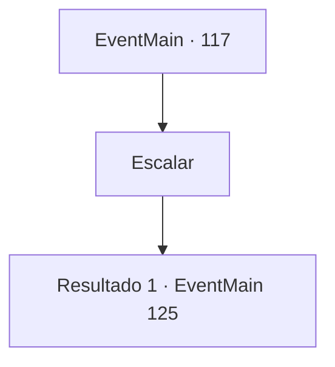

# Eventos principais · 117

[Índice da tabela](index.md) · [Índice geral](../index.md)

ID: `pt:EventMain:117` · Fonte: `EventMain4` · Versão: 1.2.47.

Mapeamento estático dos arquivos; a disponibilidade e a execução dependem do estado da run.

## Texto do evento

*Sem texto no arquivo.*

## Dados de entrada

```json
{
  "id": 117,
  "grade": 1,
  "normalGoal": "",
  "required": ""
}
```

## Mapa das escolhas



## Escolhas e resultados

### Escolha 1

Escalar

Requisitos e outros campos da escolha:

```json
{
  "required": ""
}
```

#### Resultado 1.1

Você corre atrás de Terria. Quanto mais alto você sobe, mais frio fica. Você logo está se arrastando por uma nevasca. Terria parece irritada enquanto acena com a mão para parar a tempestade de neve. Vocês dois vão para o escritório do presidente no topo da torre. 

 Você está na frente do escritório do presidente. Tem uma moldura gigante para uma porta, cuja pintura confirma o visitante. Mas alguém rasgou a pintura em pedaços. Você entra no escritório e Halad se levanta de uma confortável cadeira de couro. 

 "Por que você está constantemente ficando no meu caminho? E quem é essa senhora?"


Continuação registrada: [Evento 125](0125.md) na mesma tabela.

```json
{
  "required": "",
  "chance": "1",
  "nextEvent": 125,
  "type": 2,
  "reward": ""
}
```

## Referências que chegam a este evento

- [Evento 116 · escolha 1 · resultado 1](0116.md#escolha-1)
- [Evento 116 · escolha 1 · resultado 2](0116.md#escolha-1)
- [Evento 116 · escolha 1 · resultado 3](0116.md#escolha-1)
- [Evento 116 · escolha 1 · resultado 4](0116.md#escolha-1)
