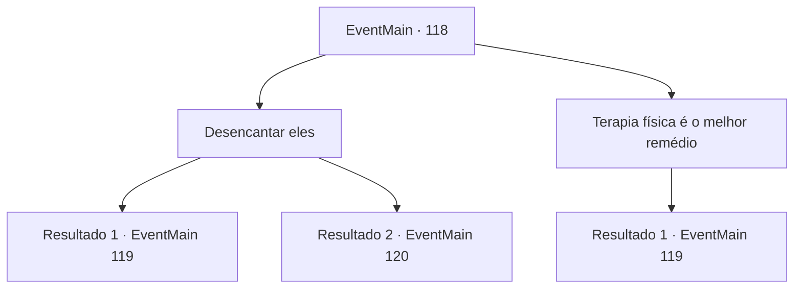

# Eventos principais · 118

[Índice da tabela](index.md) · [Índice geral](../index.md)

ID: `pt:EventMain:118` · Fonte: `EventMain4` · Versão: 1.2.47.

Mapeamento estático dos arquivos; a disponibilidade e a execução dependem do estado da run.

## Texto do evento

|drawing_floatingTower| Você encontra o Professor Flu nas planícies perto da Torre da Magia voadora. 

 "Finalmente. Vamos ao que interessa, jovem."

 Vocês dois sobem até a torre usando magia de vôo. Como esperado, a torre é cercada por uma barreira. O próprio Flu desfaz isso, dizendo para você economizar suas forças. Estudiosos enfeitiçados estão esperando por você lá dentro. Eles não parecem muito bem. Flu derrama lágrimas ao olhar para seus ex-alunos. 

 "Meus... meus alunos... por favor, quebre o feitiço para mim... Essa não é minha especialidade, entende..."


## Dados de entrada

```json
{
  "id": 118,
  "grade": 1,
  "normalGoal": "",
  "required": "13_1_13|1_2_100"
}
```

## Mapa das escolhas



## Escolhas e resultados

### Escolha 1

Desencantar eles

Requisitos e outros campos da escolha:

```json
{
  "required": "1_1_2"
}
```

#### Resultado 1.1

Você tenta desencantá-los. Mas seus feitiços são muito complicados para você desfazer. Uma vertigem toma conta de você quando os feitiços emanam energia resistente. Além disso, os estudiosos o localizam e o atacam com fúria cega.

Continuação registrada: [Evento 119](0119.md) na mesma tabela.

```json
{
  "required": "",
  "chance": "14",
  "nextEvent": 119,
  "type": 1,
  "reward": "6_3_71|0_1_-1",
  "place": 7
}
```

#### Resultado 1.2

Você desencanta com sucesso os estudiosos Eles recuperam a consciência e abraçam o professor. <link=shake>

 "Professor! E-eu... eu estava apavorado. Eu senti como... eu não era mais dono de mim mesmo, foi horrível... Muito obrigado!"

</link> Flu diz que ele estará de volta depois de evacuar os acadêmicos. Você entra na torre sozinho. As regras do mundo exterior não se aplicam ao interior, então a magia do voo não é uma opção. Você entra no saguão do primeiro andar e uma estátua de uma gárgula está esperando por você. 

 "Se identifique."


Continuação registrada: [Evento 120](0120.md) na mesma tabela.

```json
{
  "required": "",
  "chance": "1|0_7_1",
  "nextEvent": 120,
  "type": 0,
  "reward": "0_3_1"
}
```

### Escolha 2

Terapia física é o melhor remédio

Requisitos e outros campos da escolha:

```json
{
  "required": ""
}
```

#### Resultado 2.1

Você decide desencantá-los usando força bruta. Você caminha direto em direção a eles. Os estudiosos vêem você e atacam você com fúria cega.

Continuação registrada: [Evento 119](0119.md) na mesma tabela.

```json
{
  "required": "",
  "chance": "1",
  "nextEvent": 119,
  "type": 2,
  "reward": "6_3_71",
  "place": 7
}
```

## Referências que chegam a este evento

Nenhum `nextEvent` positivo da mesma tabela aponta para este nó. Isso não prova que seja inacessível: sorteio e estado de história podem selecioná-lo.

