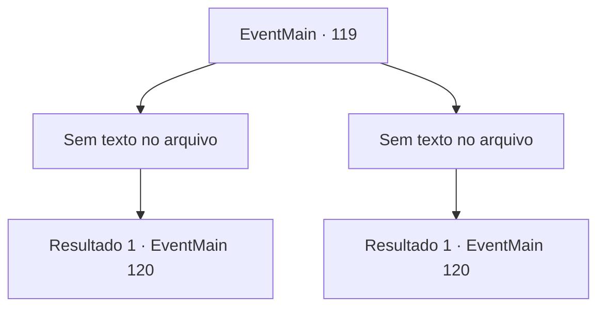

# Eventos principais · 119

[Índice da tabela](index.md) · [Índice geral](../index.md)

ID: `pt:EventMain:119` · Fonte: `EventMain4` · Versão: 1.2.47.

Mapeamento estático dos arquivos; a disponibilidade e a execução dependem do estado da run.

## Texto do evento

*Sem texto no arquivo.*

## Dados de entrada

```json
{
  "id": 119,
  "grade": 1,
  "normalGoal": "",
  "required": ""
}
```

## Mapa das escolhas



## Escolhas e resultados

### Escolha 1

*Sem texto no arquivo; o papel dessa opção depende da interface do jogo.*

Requisitos e outros campos da escolha:

```json
{
  "required": ""
}
```

#### Resultado 1.1

Você derruba todos os estudiosos. O professor fala amargamente. 

 "Suponha que eles vão acordar desencantados."

 Flu diz que ele estará de volta depois de evacuar os acadêmicos. Você entra na torre sozinho. As regras do mundo exterior não se aplicam ao interior, então a magia do voo não é uma opção. Você entra no saguão do primeiro andar e uma estátua de uma gárgula está esperando por você. 

 "Se identifique."


Continuação registrada: [Evento 120](0120.md) na mesma tabela.

```json
{
  "required": "",
  "chance": "1",
  "nextEvent": 120,
  "type": 2,
  "reward": ""
}
```

### Escolha 2

*Sem texto no arquivo; o papel dessa opção depende da interface do jogo.*

Requisitos e outros campos da escolha:

```json
{
  "required": ""
}
```

#### Resultado 2.1

À medida que os estudiosos o sobrecarregam, o professor intervém para impedi-los. 

 "Vá em frente! Eu estarei bem atrás de você!"

 Você deixa o Flu para trás e continua a subir a torre. As regras do mundo exterior não se aplicam ao interior, então a magia do voo não é uma opção. Você entra no saguão do primeiro andar e uma estátua de uma gárgula está esperando por você. 

 "Se identifique."


Continuação registrada: [Evento 120](0120.md) na mesma tabela.

```json
{
  "required": "",
  "chance": "1",
  "nextEvent": 120,
  "type": 2,
  "reward": ""
}
```

## Referências que chegam a este evento

- [Evento 118 · escolha 1 · resultado 1](0118.md#escolha-1)
- [Evento 118 · escolha 2 · resultado 1](0118.md#escolha-2)
