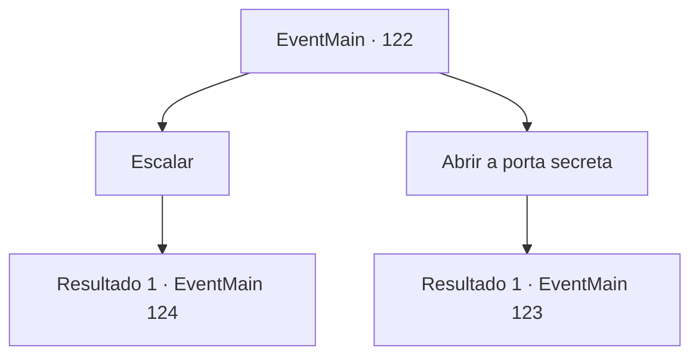

# Eventos principais · 122

[Índice da tabela](index.md) · [Índice geral](../index.md)

ID: `pt:EventMain:122` · Fonte: `EventMain4` · Versão: 1.2.47.

Mapeamento estático dos arquivos; a disponibilidade e a execução dependem do estado da run.

## Texto do evento

*Sem texto no arquivo.*

## Dados de entrada

```json
{
  "id": 122,
  "grade": 1,
  "normalGoal": "",
  "required": ""
}
```

## Mapa das escolhas



## Escolhas e resultados

### Escolha 1

Escalar

Requisitos e outros campos da escolha:

```json
{
  "required": ""
}
```

#### Resultado 1.1

Quanto mais alto você sobe, mais frio fica. Você logo está se arrastando por uma nevasca. Você pode continuar ou se tornar uma barreira protetora. O frio desgastará seu corpo, mas a barreira sobrecarregará sua mente. Só então, você ouve passos atrás. Você se vira para ver Flu ofegante enquanto ele sobe as escadas. Ele fica ao seu lado e recupera o fôlego antes de formar uma barreira. 

 "Meu... meus joelhos, meu Deus... ufa... Siga-me. Há uma passagem secreta no meu laboratório."

 Ele leva você ao seu laboratório. O laboratório da gripe cheira a poeira velha, cheio até a borda com textos antigos e tábuas de pedra. Ele dá uma olhada nostálgica no lugar antes de correr para a lareira.

Continuação registrada: [Evento 124](0124.md) na mesma tabela.

```json
{
  "required": "",
  "chance": "1",
  "nextEvent": 124,
  "type": 2,
  "reward": ""
}
```

### Escolha 2

Abrir a porta secreta

Requisitos e outros campos da escolha:

```json
{
  "required": "1_14_10|5_68_0"
}
```

#### Resultado 2.1

Você percebe algo estranho no fluxo de ar. Após uma inspeção mais detalhada, você encontra uma porta secreta. Atrás dele está um cadáver mumificado vestido com roupas extravagantes e segurando um diário empoeirado. |drawing_deadAndDiary| Só então, você ouve passos atrás. Você se vira para ver Flu ofegante enquanto ele sobe as escadas. Ele fica ao seu lado e recupera o fôlego antes de formar uma barreira. 

 "Meu... meus joelhos, meu Deus... ufa... Siga-me. Há uma passagem secreta no meu laboratório."

 Então ele vê o corpo e prende a respiração. A gripe fica paralisada por um momento antes de pegar o diário com cuidado. Ele entrega para você. 

 "Leia o que diz para mim, por favor. Está ficando difícil de ler ultimamente..."


Continuação registrada: [Evento 123](0123.md) na mesma tabela.

```json
{
  "required": "",
  "chance": "1",
  "nextEvent": 123,
  "type": 2,
  "reward": "0_2_1|5_68_1"
}
```

## Referências que chegam a este evento

- [Evento 120 · escolha 2 · resultado 3](0120.md#escolha-2)
- [Evento 121 · escolha 1 · resultado 1](0121.md#escolha-1)
- [Evento 121 · escolha 2 · resultado 1](0121.md#escolha-2)
