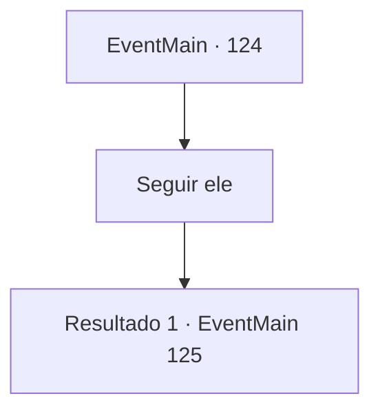

# Eventos principais · 124

[Índice da tabela](index.md) · [Índice geral](../index.md)

ID: `pt:EventMain:124` · Fonte: `EventMain4` · Versão: 1.2.47.

Mapeamento estático dos arquivos; a disponibilidade e a execução dependem do estado da run.

## Texto do evento

*Sem texto no arquivo.*

## Dados de entrada

```json
{
  "id": 124,
  "grade": 1,
  "normalGoal": "",
  "required": ""
}
```

## Mapa das escolhas



## Escolhas e resultados

### Escolha 1

Seguir ele

Requisitos e outros campos da escolha:

```json
{
  "required": ""
}
```

#### Resultado 1.1

Você se enfia na lareira. De repente, a chaminé suga você e o atira para cima, cuspindo você para o escritório do presidente. A lareira do laboratório deve estar conectada a este escritório no topo da Torre da Magia. Você olha para cima e vê Halad diante de seus olhos. Ela pula um pouco em sua confortável cadeira de couro, pega de surpresa. 

 "O que... como você...? Ah, é o Professor Flu... e o que falhou."

 Ela franze a testa enquanto continua. 

 "Eu... não entendo. Por que você está constantemente no meu caminho?"


Continuação registrada: [Evento 125](0125.md) na mesma tabela.

```json
{
  "required": "",
  "chance": "1",
  "nextEvent": 125,
  "type": 2,
  "reward": ""
}
```

## Referências que chegam a este evento

- [Evento 113 · escolha 3 · resultado 2](0113.md#escolha-3)
- [Evento 122 · escolha 1 · resultado 1](0122.md#escolha-1)
- [Evento 123 · escolha 3 · resultado 1](0123.md#escolha-3)
