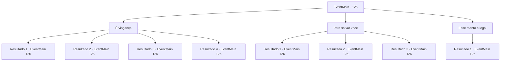

# Eventos principais · 125

[Índice da tabela](index.md) · [Índice geral](../index.md)

ID: `pt:EventMain:125` · Fonte: `EventMain4` · Versão: 1.2.47.

Mapeamento estático dos arquivos; a disponibilidade e a execução dependem do estado da run.

## Texto do evento

*Sem texto no arquivo.*

## Dados de entrada

```json
{
  "id": 125,
  "grade": 1,
  "normalGoal": "",
  "required": ""
}
```

## Mapa das escolhas



## Escolhas e resultados

### Escolha 1

É vingança

Requisitos e outros campos da escolha:

```json
{
  "required": ""
}
```

#### Resultado 1.1

Você diz a ela que está apenas retribuindo o favor dela. Halad se levanta, varinha na mão. 

 "Vou lembrá-lo do que acontece com as pessoas no meu caminho."

 Com isso, dezenas de fragmentos de gelo saem da ponta de sua varinha. Mas você percebe que eles não são reais. Você quebra a ilusão com facilidade. Halad fica um pouco surpreso. 

 "Ah... vejo que você melhorou. Vamos direto ao assunto, então."

 Ela planta os pés no chão e aponta a varinha para você.

Continuação registrada: [Evento 126](0126.md) na mesma tabela.

```json
{
  "required": "13_1_11",
  "chance": "1",
  "nextEvent": 126,
  "type": 2,
  "reward": "6_0_79",
  "place": 10
}
```

#### Resultado 1.2

Você diz a ela que está apenas retribuindo o favor dela. Halad se levanta, varinha na mão. 

 "Vou lembrá-lo do que acontece com as pessoas no meu caminho. Edmond!"

 É o nome do presidente.
 Um manto no chão de repente se levanta e assume a forma humana. |drawing_wormThatWalk| Mas todo o corpo do presidente foi substituído por vermes rastejantes. A abominação ambulante fala com a voz do presidente. 

 "Terria o índigo... Já faz um tempo..."

 Terria sorri com um canto da boca, zombando do que aconteceu com o grande 'Mestre da Torre da Magia'. Terria o enfrenta enquanto você enfrenta Halad.

Continuação registrada: [Evento 126](0126.md) na mesma tabela.

```json
{
  "required": "13_1_12",
  "chance": "1",
  "nextEvent": 126,
  "type": 2,
  "reward": "6_0_79",
  "place": 10
}
```

#### Resultado 1.3

Você diz a ela que está apenas retribuindo o favor dela. Halad se levanta, varinha na mão. 

 "Vou lembrá-lo do que acontece com as pessoas no meu caminho. Edmond!"

 É o nome do presidente.
 Um manto no chão de repente se levanta e assume a forma humana. |drawing_wormThatWalk| Mas todo o corpo do presidente foi substituído por vermes rastejantes. A abominação ambulante fala com a voz do presidente. 

 "Gripe..."

 A gripe está tremendo. Ele não consegue controlar sua raiva. <link=shake>

 "Seu verme imundo... Como ousa humilhar meu amigo!"

</link> A gripe o enfrenta enquanto você enfrenta Halad.

Continuação registrada: [Evento 126](0126.md) na mesma tabela.

```json
{
  "required": "13_1_13",
  "chance": "1",
  "nextEvent": 126,
  "type": 2,
  "reward": "6_0_79",
  "place": 10
}
```

#### Resultado 1.4

Você diz a ela que está apenas retribuindo o favor dela. Halad se levanta, varinha na mão. 

 "Vou lembrá-lo do que acontece com as pessoas no meu caminho."

 Com isso, dezenas de fragmentos de gelo saem da ponta de sua varinha. Mas você percebe que eles não são reais. Você quebra a ilusão com facilidade. Halad fica um pouco surpreso. 

 "Ah... vejo que você melhorou. Vamos direto ao assunto, então."

 Ela planta os pés no chão e aponta a varinha para você.

Continuação registrada: [Evento 126](0126.md) na mesma tabela.

```json
{
  "required": "13_1_14",
  "chance": "1",
  "nextEvent": 126,
  "type": 2,
  "reward": "6_0_79",
  "place": 10
}
```

### Escolha 2

Para salvar você

Requisitos e outros campos da escolha:

```json
{
  "required": "5_68_3"
}
```

#### Resultado 2.1

Você diz a Halad que ela foi dominada pelo texto proibido e que você a salvará. Ela pergunta com a voz confusa. 

 "Você? Salvar? Eu? Do livro falado...?"

 Então ela balança a cabeça e ri. Sua risada vem de aborrecimento e não de alegria. Ela para e range os dentes. 

 "Por que você não se preocupa com sua própria vida em vez de ousar ter pena da minha?"

 Ela se levanta e aponta sua varinha para você.

Continuação registrada: [Evento 126](0126.md) na mesma tabela.

```json
{
  "required": "13_1_11",
  "chance": "1",
  "nextEvent": 126,
  "type": 2,
  "reward": "6_2_79|5_68_4",
  "place": 10
}
```

#### Resultado 2.2

Você diz a Halad que ela foi dominada pelo texto proibido e que você a salvará. Ela pergunta com a voz confusa. 

 "Você? Salvar? Eu? Do livro falado...?"

 Então ela balança a cabeça e ri. Sua risada vem de aborrecimento e não de alegria. Ela para e range os dentes. 

 "Por que você não se preocupa com sua própria vida em vez de ousar ter pena da minha? Edmond!"

 Ela se levanta e aponta a varinha para você, gritando o nome do presidente.
 Um manto no chão de repente se levanta e assume a forma humana. |drawing_wormThatWalk| Mas todo o corpo do presidente foi substituído por vermes rastejantes. A abominação ambulante fala com a voz do presidente. 

 "Gripe..."

 A gripe está tremendo. Ele não consegue controlar sua raiva. <link=shake>

 "Seu verme imundo... Como ousa humilhar meu amigo!"

</link> A gripe o enfrenta enquanto você enfrenta Halad.

Continuação registrada: [Evento 126](0126.md) na mesma tabela.

```json
{
  "required": "13_1_13",
  "chance": "1",
  "nextEvent": 126,
  "type": 2,
  "reward": "6_2_79|5_68_4",
  "place": 10
}
```

#### Resultado 2.3

Você diz a Halad que ela foi dominada pelo texto proibido e que você a salvará. Ela pergunta com a voz confusa. 

 "Você? Salvar? Eu? Do livro falado...?"

 Então ela balança a cabeça e ri. Sua risada vem de aborrecimento e não de alegria. Ela para e range os dentes. 

 "Por que você não se preocupa com sua própria vida em vez de ousar ter pena da minha?"

 Ela se levanta e aponta sua varinha para você.

Continuação registrada: [Evento 126](0126.md) na mesma tabela.

```json
{
  "required": "13_1_14",
  "chance": "1",
  "nextEvent": 126,
  "type": 2,
  "reward": "6_2_79|5_68_4",
  "place": 10
}
```

### Escolha 3

Esse manto é legal

Requisitos e outros campos da escolha:

```json
{
  "required": "8_106_1|5_76_1"
}
```

#### Resultado 3.1

 Halad olha para o seu manto. Veias aparecem em sua testa enquanto ela olha para você. <link=shake>

 "Você...você se atreve a vestir...o manto do pai?"

</link> Sua voz começa a tremer. Ela perdeu a calma. Ela chuta para fora de seu assento, varinha na mão. <color=red><link=shake>

 "Vou destruir você..."

</link></color>

Continuação registrada: [Evento 126](0126.md) na mesma tabela.

```json
{
  "required": "",
  "chance": "1",
  "nextEvent": 126,
  "type": 2,
  "reward": "6_3_79|5_76_2",
  "place": 10
}
```

## Referências que chegam a este evento

- [Evento 110 · escolha 1 · resultado 2](0110.md#escolha-1)
- [Evento 112 · escolha 1 · resultado 1](0112.md#escolha-1)
- [Evento 117 · escolha 1 · resultado 1](0117.md#escolha-1)
- [Evento 124 · escolha 1 · resultado 1](0124.md#escolha-1)
