# Eventos principais · 126

[Índice da tabela](index.md) · [Índice geral](../index.md)

ID: `pt:EventMain:126` · Fonte: `EventMain4` · Versão: 1.2.47.

Mapeamento estático dos arquivos; a disponibilidade e a execução dependem do estado da run.

## Texto do evento

*Sem texto no arquivo.*

## Dados de entrada

```json
{
  "id": 126,
  "grade": 1,
  "normalGoal": "",
  "required": ""
}
```

## Mapa das escolhas

```mermaid
flowchart TD
  E["EventMain · 126"]
  C0["Sem texto no arquivo"]
  E --> C0
  R0_0["Resultado 1 · EventMain 133"]
  C0 --> R0_0
  R0_1["Resultado 2 · EventMain 127"]
  C0 --> R0_1
  R0_2["Resultado 3 · EventMain 129"]
  C0 --> R0_2
  R0_3["Resultado 4 · EventMain 131"]
  C0 --> R0_3
  R0_4["Resultado 5 · EventMain 127"]
  C0 --> R0_4
  R0_5["Resultado 6 · EventMain 128"]
  C0 --> R0_5
  C1["Sem texto no arquivo"]
  E --> C1
  R1_0["Resultado 1 · Destino especial -1"]
  C1 --> R1_0
  R1_1["Resultado 2 · Destino especial -1"]
  C1 --> R1_1
  R1_2["Resultado 3 · Destino especial -1"]
  C1 --> R1_2
  R1_3["Resultado 4 · Destino especial -1"]
  C1 --> R1_3
  R1_4["Resultado 5 · Destino especial -1"]
  C1 --> R1_4
  R1_5["Resultado 6 · EventMain 130"]
  C1 --> R1_5
  R1_6["Resultado 7 · EventMain 132"]
  C1 --> R1_6
  R1_7["Resultado 8 · EventMain 212"]
  C1 --> R1_7
  R1_8["Resultado 9 · EventMain 212"]
  C1 --> R1_8
```



## Escolhas e resultados

### Escolha 1

*Sem texto no arquivo; o papel dessa opção depende da interface do jogo.*

Requisitos e outros campos da escolha:

```json
{
  "required": ""
}
```

#### Resultado 1.1

Você derrota Halad. Ela está deitada no chão, respirando pesadamente. Ela está chocada com a forma como as coisas aconteceram. 

 "Como... o que... eu perdi... para um ninguém... Edmond... Edmond!"

 Você sente imensa frustração na voz de Halad enquanto ela grita o nome do presidente. Um manto no chão de repente se levanta e assume a forma humana. |drawing_wormThatWalk| Mas todo o corpo do presidente foi substituído por vermes rastejantes. Halad ordena que o enxame mate você. Mas eles balançam a cabeça em recusa. 

 "Eu prefiro não lutar com meu aluno. E você... você realmente não quer dizer isso de qualquer maneira, não é."

 Lentamente, eles passam por você e folheiam algumas páginas de um livro da estante. Assim que você se pergunta o que eles estão fazendo quando a estante se move para revelar uma sala escondida.

Continuação registrada: [Evento 133](0133.md) na mesma tabela.

```json
{
  "required": "13_1_11|5_68_4",
  "chance": "1",
  "nextEvent": 133,
  "type": 2,
  "reward": ""
}
```

#### Resultado 1.2

Você derrota Halad. Ela está deitada no chão, respirando pesadamente. Ela está chocada com a forma como as coisas aconteceram. 

 "Como... o que... eu perdi... para um ninguém... Edmond... Edmond!"

 Você sente imensa frustração na voz de Halad enquanto ela grita o nome do presidente. Um manto no chão de repente se levanta e assume a forma humana. |drawing_wormThatWalk| Mas todo o corpo do presidente foi substituído por vermes rastejantes. Halad ordena que o enxame mate você. Eles olham para você em silêncio.

Continuação registrada: [Evento 127](0127.md) na mesma tabela.

```json
{
  "required": "13_1_11|18_68_4",
  "chance": "1",
  "nextEvent": 127,
  "type": 2,
  "reward": ""
}
```

#### Resultado 1.3

Você derrota Halad e verifica Terria. Ela derrotou o presidente impostor há muito tempo e tem observado você lutar desde então. Chocada com sua própria derrota, Halad cai no chão. 

 "Como... o que... eu perdi... para um ninguém..."

 Terria se aproxima e bate na testa de Halad com a ponta de sua varinha. Halad desmaia. 

 "Agora, vamos cuidar do assustador atrás daquela estante."

 Você sente algo por trás disso, também. Você empurra a estante de lado para revelar uma sala escondida.

Continuação registrada: [Evento 129](0129.md) na mesma tabela.

```json
{
  "required": "13_1_12",
  "chance": "1",
  "nextEvent": 129,
  "type": 2,
  "reward": ""
}
```

#### Resultado 1.4

Você derrota Halad e verifica o Flu. Ele acabou de derrotar o presidente impostor. Chocada com sua própria derrota, Halad cai no chão. 

 "Como... o que... eu perdi... para um ninguém..."

 O professor a olha por um momento, depois se vira para você. Então ele folheia algumas páginas de um livro da estante. Assim que você se pergunta o que eles estão fazendo quando a estante se move para revelar uma sala escondida.

Continuação registrada: [Evento 131](0131.md) na mesma tabela.

```json
{
  "required": "13_1_13",
  "chance": "1",
  "nextEvent": 131,
  "type": 2,
  "reward": ""
}
```

#### Resultado 1.5

Você derrota Halad. Ela está deitada no chão, respirando pesadamente. Ela está chocada com a forma como as coisas aconteceram. 

 "Como... o que... eu perdi... para um ninguém... Edmond... Edmond!"

 Você sente imensa frustração na voz de Halad enquanto ela grita o nome do presidente. Um manto no chão de repente se levanta e assume a forma humana. |drawing_wormThatWalk| Mas todo o corpo do presidente foi substituído por vermes rastejantes. Halad ordena que o enxame mate você. Eles olham para você em silêncio.

Continuação registrada: [Evento 127](0127.md) na mesma tabela.

```json
{
  "required": "5_76_2",
  "chance": "1",
  "nextEvent": 127,
  "type": 2,
  "reward": ""
}
```

#### Resultado 1.6

Você derrota Halad. Ela está deitada no chão, respirando pesadamente. Ela está chocada com a forma como as coisas aconteceram. 

 "Como... o que... eu perdi... para um ninguém... Edmond... Edmond!"

 Você sente imensa frustração na voz de Halad enquanto ela grita o nome do presidente. Um manto no chão de repente se levanta e assume a forma humana. |drawing_wormThatWalk| Mas todo o corpo do presidente foi substituído por vermes rastejantes. Halad ordena que o enxame mate você. De repente, todos os acadêmicos que você salvou correm para o escritório. 

 "Halad... Esses vermes... eles são o Presidente Edmond...?"

 "Eu não posso acreditar.."

 Os estudiosos estão chocados. Um deles atira uma bola de fogo em negação, que inicia uma luta entre eles e o enxame.

Continuação registrada: [Evento 128](0128.md) na mesma tabela.

```json
{
  "required": "13_1_14",
  "chance": "1",
  "nextEvent": 128,
  "type": 2,
  "reward": "6_2_80",
  "place": 10
}
```

### Escolha 2

*Sem texto no arquivo; o papel dessa opção depende da interface do jogo.*

Requisitos e outros campos da escolha:

```json
{
  "required": ""
}
```

#### Resultado 2.1

Você não é páreo para Halad. Ela caminha até onde você desmaiou e traz a ponta da varinha para sua testa. 

 "Bom, bom... Vou me certificar de que você nunca mais fique no meu caminho. Dominato Geass!"

 E com isso, você perde o controle sobre seu corpo.

Continuação registrada: [Destino especial `-1`](../destinos-especiais.md).

```json
{
  "required": "13_1_11|24_7_1|18_76_2|24_1_1",
  "chance": "1",
  "nextEvent": -1,
  "type": 2,
  "reward": "15_2_0"
}
```

#### Resultado 2.2

Você não é páreo para Halad. Ela caminha até onde você desmaiou e traz a ponta da varinha para sua testa. 

 "Bom, bom... Vou me certificar de que você nunca mais fique no meu caminho. Dominato Geass!"

 E com isso, você perde o controle sobre seu corpo.

Continuação registrada: [Destino especial `-1`](../destinos-especiais.md).

```json
{
  "required": "5_76_2|24_1_1",
  "chance": "1",
  "nextEvent": -1,
  "type": 2,
  "reward": "15_2_1"
}
```

#### Resultado 2.3

Você não é páreo para Halad. Ela caminha até onde você desmaiou e traz a ponta da varinha para sua testa. 

 "Bom, bom... Vou me certificar de que você nunca mais fique no meu caminho. Dominato Geass!"

 E com isso, você perde o controle sobre seu corpo.

Continuação registrada: [Destino especial `-1`](../destinos-especiais.md).

```json
{
  "required": "13_1_11|24_7_1|18_76_2|23_1_1",
  "chance": "1",
  "nextEvent": -1,
  "type": 2,
  "reward": "15_2_0|25_8_1|15_2_21"
}
```

#### Resultado 2.4

Você não é páreo para Halad. Ela caminha até onde você desmaiou e traz a ponta da varinha para sua testa. 

 "Bom, bom... Vou me certificar de que você nunca mais fique no meu caminho. Dominato Geass!"

 E com isso, você perde o controle sobre seu corpo.

Continuação registrada: [Destino especial `-1`](../destinos-especiais.md).

```json
{
  "required": "5_76_2|23_1_1",
  "chance": "1",
  "nextEvent": -1,
  "type": 2,
  "reward": "15_2_1|25_8_1"
}
```

#### Resultado 2.5

Você não é páreo para Halad. Ela caminha até onde você desmaiou e traz a ponta da varinha para sua testa. 

 "Bom, bom... vou me certificar de que você nunca fique no meu caminho de novo-"

 Os estudiosos a interrompem enquanto se aglomeram no escritório. Essa é a última coisa que você vê antes de desmaiar.

Continuação registrada: [Destino especial `-1`](../destinos-especiais.md).

```json
{
  "required": "13_1_14",
  "chance": "1",
  "nextEvent": -1,
  "type": 2,
  "reward": "15_2_2"
}
```

#### Resultado 2.6

Você não é páreo para Halad. Ela tenta caminhar até onde você desmaiou, mas Terria está entre vocês dois. 

 "Vá verificar atrás daquela estante, pequena. Vou levá-lo daqui."

 A Bruxa Índigo começa a lutar contra Halad. Você faz o que ela diz e verifica a estante. Você empurra a estante de lado para revelar uma sala escondida.

Continuação registrada: [Evento 130](0130.md) na mesma tabela.

```json
{
  "required": "13_1_12",
  "chance": "1",
  "nextEvent": 130,
  "type": 2,
  "reward": ""
}
```

#### Resultado 2.7

Você não é páreo para Halad. Ela caminha até onde você desmaiou e traz a ponta da varinha para sua testa. 

 "Bom, bom... Vou me certificar de que você nunca mais fique no meu caminho."

 De repente, a estante no canto do escritório se move para revelar uma sala escondida. A gripe corre pela abertura. Assustado, Halad o segue.

Continuação registrada: [Evento 132](0132.md) na mesma tabela.

```json
{
  "required": "13_1_13",
  "chance": "1",
  "nextEvent": 132,
  "type": 2,
  "reward": ""
}
```

#### Resultado 2.8

Você não é páreo para Halad. Ela caminha até onde você desmaiou e traz a ponta da varinha para sua testa. 

 "Bom, bom... Vou me certificar de que você nunca mais fique no meu caminho. Dominato Geass!"

 No entanto, o feitiço dela não funciona para você.

Continuação registrada: [Evento 212](0212.md) na mesma tabela.

```json
{
  "required": "13_1_11|23_7_1",
  "chance": "1",
  "nextEvent": 212,
  "type": 2,
  "reward": ""
}
```

#### Resultado 2.9

Você não é páreo para Halad. Ela caminha até onde você desmaiou e traz a ponta da varinha para sua testa. 

 "Bom, bom... Vou me certificar de que você nunca mais fique no meu caminho. Dominato Geass!"

 No entanto, o feitiço dela não funciona para você. Foi porque a língua de Daily Kim destruiu seu feitiço.

Continuação registrada: [Evento 212](0212.md) na mesma tabela.

```json
{
  "required": "13_1_11|20_55_1",
  "chance": "1",
  "nextEvent": 212,
  "type": 2,
  "reward": ""
}
```

## Referências que chegam a este evento

- [Evento 125 · escolha 1 · resultado 1](0125.md#escolha-1)
- [Evento 125 · escolha 1 · resultado 2](0125.md#escolha-1)
- [Evento 125 · escolha 1 · resultado 3](0125.md#escolha-1)
- [Evento 125 · escolha 1 · resultado 4](0125.md#escolha-1)
- [Evento 125 · escolha 2 · resultado 1](0125.md#escolha-2)
- [Evento 125 · escolha 2 · resultado 2](0125.md#escolha-2)
- [Evento 125 · escolha 2 · resultado 3](0125.md#escolha-2)
- [Evento 125 · escolha 3 · resultado 1](0125.md#escolha-3)
